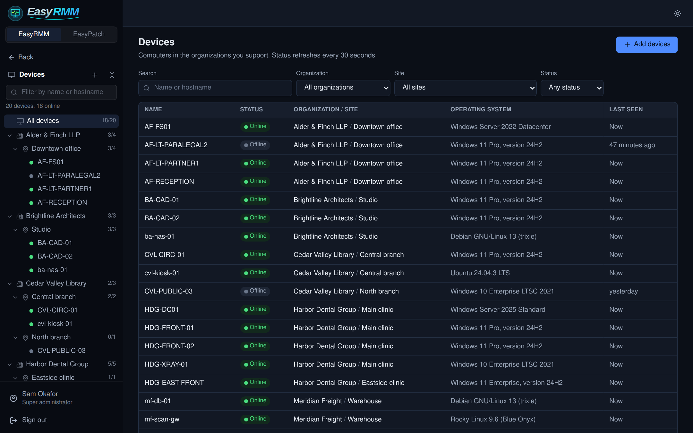
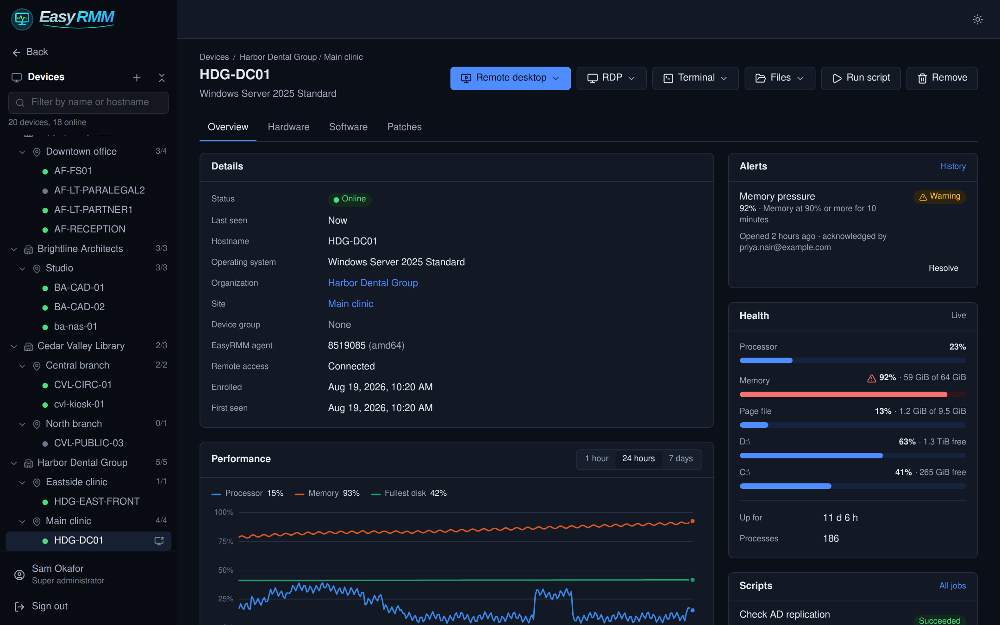

<p align="center">
  
</p>
<h1 align="center">
  <picture>
    <source media="(prefers-color-scheme: dark)" srcset="web/public/wordmark.svg">
    
  </picture>
</h1>

<p align="center">
  <b>Self-hosted remote monitoring, management and patching for Managed Service Providers.</b><br>
  Windows first, Linux too. One server, one console, one agent install.
</p>

<p align="center">
  <a href="https://github.com/paulmataruso/EasyRMM/actions/workflows/ci.yml"></a>
  <a href="https://github.com/paulmataruso/EasyRMM/releases"></a>
  <a href="LICENSE.md"></a>
  
</p>

<p align="center">
  <a href="#features">Features</a> ·
  <a href="#screenshots">Screenshots</a> ·
  <a href="#quick-start">Quick start</a> ·
  <a href="#architecture">Architecture</a> ·
  <a href="#documentation">Documentation</a> ·
  <a href="#licensing">Licensing</a>
</p>

EasyRMM looks after your clients' computers from one console that you host
yourself: remote desktop and terminal, inventory, monitoring and alerts,
scripts, software, reports and patching, for every organization and site you
manage, behind roles and a tamper-evident audit log. Computers join with one
command and only ever connect out, over HTTPS.

<picture>
  <source media="(prefers-color-scheme: light)" srcset="docs/images/dashboard-light.png">
  
</picture>

> **Status: release candidate.** [1.0.0-rc.3](https://github.com/paulmataruso/EasyRMM/releases)
> is out for testing. On real Windows Server 2025 and Linux computers we
> have run the install command and enrollment (with approval, on Linux),
> inventory, remote desktop, terminal and files, scripts, the EasyPatch
> agent's install and scans, and an in-place upgrade from rc.1 in which
> every agent updated itself.
> [`IMPLEMENTATION_STATUS.md`](IMPLEMENTATION_STATUS.md) says what works and
> how each part was verified; [`ROADMAP.md`](ROADMAP.md) says what is left
> before 1.0.0.

## Features

**Endpoints**

* **One install command** per computer: PowerShell on Windows, a shell line
  on Linux. It installs the EasyRMM agent and MeshAgent and enrolls the
  computer, into a site, or to wait for your approval when one command goes
  to many customers.
* **Outbound only.** Computers connect to your server on 443. No VPN,
  inbound firewall rule or port forwarding.
* **Agent updates** rolled out a few computers at a time, signed by your
  server, with a rollback when a new build cannot reach it.

**Remote access**

* **Remote desktop, RDP, terminal and files** in the console, through
  MeshCentral, which runs inside the deployment and is never reachable on
  its own. EasyRMM checks the permission and records each session before it
  opens.

**Monitoring and automation**

* **Inventory**: hardware, operating system, network and installed software.
* **Monitoring and alerts**: processor, memory, disk and offline policies,
  acknowledged and resolved in the console. (Email and webhook
  notifications so far go out for patching alerts only.)
* **Scripts and jobs**: a script library, run on one computer or many, with
  each one's output.
* **Software deployment** with winget, Chocolatey, APT, DNF, YUM and Zypper.
* **Reports** of devices, software and health, to read or download as CSV.

**Patching**

* **Windows Update, apt and dnf**, plus winget application updates on
  Windows, through the EasyPatch agent, which EasyRMM installs for you. It
  patches only: no remote shell and no command execution.
* **Known-exploited first**: the CVEs each update fixes, and the updates for
  vulnerabilities in CISA's Known Exploited Vulnerabilities catalog.
* **Policies** for organizations, sites, devices and tags: maintenance
  windows, rollout delays, restart schedules, Windows Update settings.
* **Verified results**: an update counts as installed only when a scan
  confirms it, and a rollout guard holds an update that fails too often.
* **Compliance reports**, monthly PDFs per customer, emailed on a schedule.
* **Patching alerts** by email or webhook (Slack, Microsoft Teams or any
  `https://` address).

**Security and tenancy**

* **Organizations, sites and device groups**, isolated in the database by
  row-level security, with five roles granted per organization or site.
* **Sign-in** with a password and a second factor (authenticator app,
  security key or passkey), or single sign-on with OpenID Connect. Authentik
  can be installed alongside with one option.
* **Audit log**, hash-chained so tampering shows, and forwarded to syslog if
  you want.

## Screenshots

The screenshots show fictional demo data, made from the console's
production build with `npm run screenshots` in `web/`.

<table>
  <tr>
    <td width="50%">
      <a href="docs/images/devices.png"><picture><source media="(prefers-color-scheme: light)" srcset="docs/images/devices-light.png"></picture></a>
      <br><sub><b>Devices.</b> Every organization's computers, grouped by organization and site.</sub>
    </td>
    <td width="50%">
      <a href="docs/images/device.png"><picture><source media="(prefers-color-scheme: light)" srcset="docs/images/device-light.png"></picture></a>
      <br><sub><b>A device.</b> Remote desktop, RDP, terminal and files; health, alerts and script runs.</sub>
    </td>
  </tr>
  <tr>
    <td>
      <a href="docs/images/patching.png"><picture><source media="(prefers-color-scheme: light)" srcset="docs/images/patching-light.png"></picture></a>
      <br><sub><b>Patching.</b> The patch status of every device.</sub>
    </td>
    <td>
      <a href="docs/images/device-patches.png"><picture><source media="(prefers-color-scheme: light)" srcset="docs/images/device-patches-light.png"></picture></a>
      <br><sub><b>A device's updates.</b> Scan, install and restart; the policy in effect, value by value.</sub>
    </td>
  </tr>
  <tr>
    <td>
      <a href="docs/images/alerts.png"><picture><source media="(prefers-color-scheme: light)" srcset="docs/images/alerts-light.png"></picture></a>
      <br><sub><b>Alerts.</b> Disk, processor, memory and offline policies, acknowledged and resolved by people.</sub>
    </td>
    <td>
      <a href="docs/images/patching-overview.png"><picture><source media="(prefers-color-scheme: light)" srcset="docs/images/patching-overview-light.png"></picture></a>
      <br><sub><b>Patching overview.</b> How far each organization is up to date, and what needs attention first.</sub>
    </td>
  </tr>
</table>

## Quick start

You need a Linux host (x86-64 or arm64) with Docker Engine 24+ and the
Compose plugin, inbound TCP 443, and preferably two DNS names for it, such
as `rmm.example.com` and `mesh.rmm.example.com`. Without DNS it runs on the
host's IP address.

```bash
curl -LO https://github.com/paulmataruso/EasyRMM/releases/download/easyrmm-v1.0.0-rc.3/easyrmm-v1.0.0-rc.3-deploy.tar.gz
tar -xzf easyrmm-v1.0.0-rc.3-deploy.tar.gz
cd easyrmm-v1.0.0-rc.3/deploy
sudo ./scripts/setup.sh --hostname rmm.example.com --acme-email you@example.com
sudo docker compose up -d
```

Open `https://rmm.example.com/`, paste the one-time setup token the server
writes to `/srv/easyrmm/server/setup-token`, and create the first
administrator. Then add computers from **Devices → Add devices**.

The [Docker deployment guide](docs/deployment/docker.md) covers TLS modes,
running without DNS, running behind NGINX, Authentik and backups. Check a
release before installing it as [CODE_SIGNING.md](CODE_SIGNING.md#verifying-a-release)
describes.

## Architecture


* **One Docker Compose deployment on host networking**: EasyRMM's server,
  MeshCentral, the patching engine's API and worker, and PostgreSQL. Only the
  server listens publicly; everything else is on loopback.
* **The server** is a Go modular monolith with the React console built in.
  It is the TLS edge, the API, the agents' gateway, and the gateway in front
  of MeshCentral that checks every remote session.
* **The patching engine** is EasyPatch's .NET server, built from
  [`easypatch/`](easypatch/) and released with EasyRMM. EasyRMM calls it
  with a signed statement per request, and the EasyPatch agents reach it
  through EasyRMM's address.

[docs/architecture/overview.md](docs/architecture/overview.md) explains the
design, and every decision has an ADR in
[docs/architecture/adr/](docs/architecture/adr/).

## Documentation

| | |
|---|---|
| **Deploy** | [Docker deployment](docs/deployment/docker.md) · [Behind NGINX](docs/deployment/nginx.md) · [Installing the agent](docs/deployment/agents.md) · [Upgrading](docs/operations/upgrading.md) · [Backup and restore](docs/operations/backup-restore.md) |
| **Use** | [Patching](docs/operations/patching.md) · [Alerts](docs/operations/alerts.md) · [Scripts and jobs](docs/operations/scripts-and-jobs.md) · [Software](docs/operations/software.md) · [Inventory](docs/operations/inventory.md) · [Reports](docs/operations/reports.md) · [Audit forwarding](docs/operations/audit-forwarding.md) |
| **Secure** | [Signing in](docs/security/sign-in.md) · [Single sign-on](docs/security/single-sign-on.md) · [Roles and permissions](docs/security/rbac.md) · [Threat model](docs/security/threat-model.md) |
| **Understand** | [Architecture](docs/architecture/overview.md) · [Network and ports](docs/architecture/network.md) · [Database](docs/architecture/database.md) · [Decisions (ADRs)](docs/architecture/adr/) |
| **Develop** | [Development guide](docs/development/README.md) · [Contributing](CONTRIBUTING.md) · [Releasing](docs/development/releasing.md) |

All of it, in one list: [docs/README.md](docs/README.md).

## Security and privacy

Report vulnerabilities privately, as [SECURITY.md](SECURITY.md) describes.
EasyRMM sends nothing to us: no telemetry, no licence or update checks
([PRIVACY.md](PRIVACY.md)). What we sign, and how to check it, is in
[CODE_SIGNING.md](CODE_SIGNING.md).

## Licensing

EasyRMM is source-available under the [Functional Source License, Version
1.1, ALv2 Future License](LICENSE.md) (FSL-1.1-ALv2). Copyright 2026 DHI
Technical Services LLC.

MSPs and IT departments may run it free of charge for their own computers and
their clients', including as part of paid managed services. Selling it, or
offering it for others to run their own remote management or patching, is
not permitted. Each version becomes available under the Apache License 2.0
two years after its release. [LICENSING.md](LICENSING.md) has the details
and what a contribution is made under.

MeshCentral and MeshAgent are Apache-2.0 projects by their respective
authors; see [THIRD_PARTY_NOTICES.md](THIRD_PARTY_NOTICES.md). EasyRMM is not
affiliated with the MeshCentral project.
