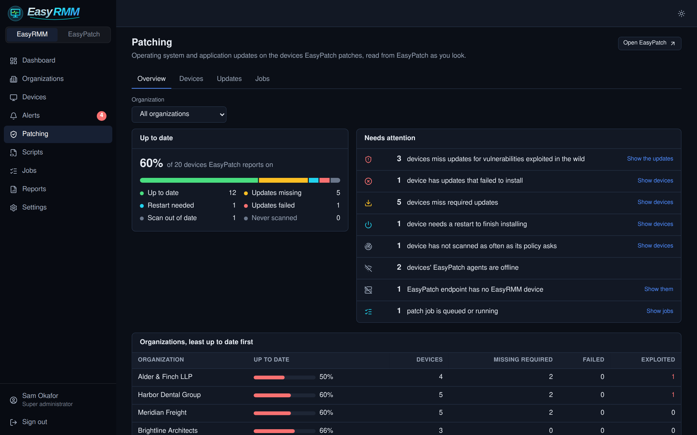

# Patching

EasyRMM patches devices through [EasyPatch](../integrations/easypatch.md):
EasyPatch keeps the update catalogue, each device's update state, the
policies and maintenance windows, and runs the scans and installs. EasyRMM
shows all of it in its own console, behind its own roles, so nobody needs
to sign in to EasyPatch for day-to-day patching. The design is in
[ADR-0030](../architecture/adr/0030-easypatch-connector.md).

## Setting it up

You need an EasyPatch server (1.9.0 or later) that the EasyRMM server can
reach over https, and a super administrator account in both. Any EasyPatch
server will do. To set one up, see EasyPatch's
[installation guide](../../easypatch/docs/installation.md), or
[EasyPatch on the same server as EasyRMM](../deployment/easypatch-cohost.md).

1. **Create an API token in EasyPatch**: Settings → API tokens. Choose the
   EasyPatch organizations EasyRMM should patch, an expiry (up to a year),
   and the role:
   * **Operator** lets EasyRMM scan, install and change organizations',
     sites' and devices' policies.
   * **Read only** lets EasyRMM show patch status, and nothing else.

   EasyPatch shows the token once; copy it.
2. **Connect EasyRMM**: Settings → EasyPatch. Enter EasyPatch's address
   (`https://patch.example.com`) and the token. If EasyPatch's certificate
   is signed by your own authority, paste that authority's certificate
   (PEM). EasyRMM checks the address and the token with EasyPatch before it
   saves anything; the token is stored encrypted and never shown again.
3. **Link organizations**: in the Organizations table, choose the EasyPatch
   organization each EasyRMM organization's devices are enrolled in. One
   EasyPatch organization serves one EasyRMM organization.
4. **Devices link themselves.** The EasyRMM agent asks the EasyPatch agent
   on the device who it is (`status --json`) and reports it with its
   inventory, at start and then hourly. Within a minute of that report
   EasyRMM checks with EasyPatch that the endpoint really is this device,
   and the device appears in **Patching**.
5. **Devices without an EasyPatch agent** can get one from EasyRMM, one at
   a time, in bulk, or automatically for a whole organization: see
   [Installing the EasyPatch agent](#installing-the-easypatch-agent).

With the patching engine in EasyRMM's own deployment
(`EASYRMM_PATCHING=bundled`, see [Docker](../deployment/docker.md)), skip
steps 1 to 3: there is no token, and EasyRMM keeps the engine's
organizations itself (see
[Organizations in the bundled engine](#organizations-in-the-bundled-engine)).

The status card shows the EasyPatch version, whether the token can act,
and two features that depend on the EasyPatch server:

* **Install later**: installs at a chosen time. Servers that do not list
  the `scheduled-installs` capability (stock EasyPatch 1.9.0) can only
  install now; EasyRMM does not offer a time there.
* **Who acted**: servers with the `on-behalf-of` capability record the
  EasyRMM user in their own audit log and on the job. Otherwise EasyPatch
  records the API token, and EasyRMM's audit log records the user.

EasyRMM checks the server every 10 minutes and records the last error.
Replacing the token for the same server: paste the new one and save.
Pointing EasyRMM at a different server forgets every organization and
device link, since they name the old server's ids.

### Organizations in the bundled engine

With the bundled engine, every EasyRMM organization and site has its own in
the engine, and EasyRMM keeps them the same
([ADR-0040](../architecture/adr/0040-one-set-of-organizations.md)):

* **Created** with EasyRMM's name and the organization's **time zone**
  (Organizations → edit; the engine's monthly reports use it), with
  automatic installs of the EasyPatch agent on. An engine organization
  with exactly the same name that nothing links yet is used instead of a
  new one.
* **Renamed** and given a new time zone when EasyRMM's changes. A name
  another engine organization already holds, in another case or archived,
  gets the first 8 characters of EasyRMM's id, as in `Acme (1a2b3c4d)`. It
  gets its plain name back when that is free.
* **Archived** when deleted in EasyRMM, renamed `… (deleted 2026-11-18
  1a2b3c4d)` so that the name can be used again. Endpoints stay in an
  archived organization. An agent EasyRMM did not remove itself keeps
  checking in until it is revoked in the engine.
* **Put back** when someone archives or deletes them in the engine's own
  console. Descriptions, notes and addresses entered there are kept.

This happens as soon as an organization or site changes, and the whole set
is compared every 5 minutes. If the engine is unavailable or refuses a
change, EasyRMM tries again every minute. Settings → EasyPatch shows when
the engine was last in step, what it could not do, and how many archives
and agent removals are waiting. Organizations are not linked by hand there.

## Installing the EasyPatch agent

The EasyRMM agent can install the EasyPatch agent on Windows and Linux
devices (x64 and arm64) that have none, and enroll it in the EasyPatch
organization linked to the device's organization. The design is in
[ADR-0031](../architecture/adr/0031-easypatch-agent-install.md). It needs
an Operator token.

* **Chosen devices**: in **Patching**, choose devices marked *No EasyPatch
  agent* and **Install EasyPatch agent…**; or on a device's **Patches** tab,
  **Install EasyPatch agent…**. Needs `patch.manage`.
* **A whole organization**: Settings → EasyPatch → Organizations, **Install
  automatically** on a linked organization. Needs `settings.manage`. Every
  minute EasyRMM looks for devices in that organization with no EasyPatch
  agent, new ones included, and installs it. A failed automatic install is
  tried again an hour later, three times in all; after that, start it by
  hand.

What happens:

1. At its next check-in (within a minute) the device's EasyRMM agent gets a
   signed instruction, valid for 15 minutes. It carries EasyPatch's address,
   the CA certificate you gave EasyRMM (if any), the newest EasyPatch agent
   package for the device, and an enrollment token. EasyRMM creates that
   token in EasyPatch for this one install: single use, valid for an hour,
   for the linked EasyPatch organization and the EasyPatch site with the
   same name as the device's EasyRMM site (no site when none has that
   name; with the bundled engine, the site EasyRMM created for it). The token is never stored, and is revoked if the install fails.
2. The agent downloads the package from EasyPatch, checks its size and
   SHA-256 against EasyPatch's list, installs it (`msiexec` on Windows,
   `apt-get` or `dnf` on Linux) and enrolls it.
3. It reports the result with its next heartbeat. The EasyPatch agent shows
   up in the next inventory, and the device links itself as above.

**Patching** and the device's **Patches** tab show where each install is:
waiting for the device, installing, installed, or failed with the reason
(installer and enrollment exit codes are put into words). An install the
agent never acknowledges fails after three minutes; one it does not finish
reporting within 30 minutes fails then.

EasyRMM never installs a second EasyPatch agent: a device whose EasyRMM
agent reports one, in any state and enrolled with any server, is left
alone, and the agent checks again just before it installs. It never
re-enrolls (`--force`) or upgrades the EasyPatch agent either; EasyPatch
updates its own agent. It removes one only as described in
[Stopping patching for a device](#stopping-patching-for-a-device) and
[Devices that move or are deleted](#devices-that-move-or-are-deleted).

Requirements:

* An EasyRMM agent that reports the EasyPatch agent's install state (this
  release or later). An older one waits, with a note, until it updates.
* **Linux**: systemd, and apt-get or dnf. If EasyPatch's certificate comes
  from a private authority (the one you gave EasyRMM, or with the bundled
  engine and `EASYRMM_TLS_MODE=internal`, EasyRMM's own), EasyRMM gives it to
  the EasyPatch agent at enrollment (`--server-ca`), which trusts it for
  EasyPatch's address only. EasyPatch agents from before that option trust
  only the device's certificate store: EasyRMM then enrolls them without it,
  and you add the authority to the store first
  (`/usr/local/share/ca-certificates` and `update-ca-certificates`, or
  `/etc/pki/ca-trust/source/anchors` and `update-ca-trust`). EasyRMM does not
  change the store.
* **Windows**: nothing more; the MSI is given the CA certificate
  (`SERVERCACERT`), and trusts it for EasyPatch's address only.
* One install at a time per device, for at most 20 minutes. An EasyRMM
  agent update waits for it.

## Stopping patching for a device

On a device's **Patches** tab, **Stop patching…** (needs `patch.manage`):

* EasyRMM drops any install of the EasyPatch agent that is waiting, and
  never installs it on the device again, automatically or by hand.
* If EasyRMM linked the device's EasyPatch agent, it sends the agent an
  uninstall job, as below. An agent EasyRMM has not confirmed as one it
  manages (enrolled with another server, say) stays installed.
* It is refused while the agent is being installed. Wait for the install to
  finish, then stop patching.

**Allow patching again** on the same tab undoes it. A removal not sent yet
is cancelled. With automatic installs on, the agent is installed again
within a minute. Otherwise, install it by hand.

## Devices that move or are deleted

* **Deleted in EasyRMM:** the device's EasyPatch agent is uninstalled. The
  removal is cancelled if another EasyRMM device links or reports the same
  endpoint, as after two device records are merged.
* **Moved to another site** of its organization: with the bundled engine,
  its endpoint moves to that site.
* **Moved to another organization:** an endpoint cannot change
  organization in EasyPatch. EasyRMM has the old agent uninstall itself.
  When it is gone, automatic installs enroll it again in the new
  organization. The device's Patches tab says so in the meantime.

EasyRMM's console has no screen to move or retire a device yet; this covers
devices merged by EasyRMM and moves made through the API.

**How an agent is removed:** EasyRMM sends EasyPatch an `uninstall-agent`
job and checks every 5 minutes. A failed or expired job is sent again. The
agent is gone when EasyPatch no longer shows its endpoint as active. If it
is not gone within 7 days, or is too old to uninstall itself, EasyRMM
revokes the endpoint in EasyPatch, which stops serving it. Removal works
with a connected server too, with an Operator token.

## When a device is not linked

EasyRMM links a device only when everything agrees, and otherwise says why
(Settings → EasyPatch → Devices not linked, and the device's Patches tab):

| Reason | What to do |
|---|---|
| The EasyPatch agent is not enrolled and active | Enroll it, or check it on the device: `sudo /opt/easypatch/easypatch-agent status` on Linux, `& "$env:ProgramFiles\EasyPatch Agent\EasyPatch.Agent.exe" status` on Windows |
| The agent is enrolled with another server | The device belongs to another EasyPatch server; re-enroll it with this one |
| The organization is not linked | Link the device's EasyRMM organization in Settings → EasyPatch. With the bundled engine, EasyRMM is still creating it: Settings → EasyPatch says why if it cannot |
| EasyPatch has no such endpoint, or the token cannot see it | Add the endpoint's EasyPatch organization to the token |
| The endpoint belongs to another EasyPatch organization | The device is enrolled in the wrong EasyPatch organization, or the EasyRMM organization is linked to the wrong one |
| The endpoint is revoked or decommissioned in EasyPatch | Re-enroll the EasyPatch agent |
| The key fingerprint is not one of the endpoint's credentials | The endpoint id was copied from another machine, or its credential was revoked; re-enroll |
| Host names or serial numbers differ | The endpoint is another machine; re-enroll the EasyPatch agent on this one |
| Another device is already linked to the endpoint | Two EasyRMM devices claim one endpoint (a cloned disk, a reinstall). Retire the stale device in EasyRMM |

Refused devices are checked again every 15 minutes, and any device as soon
as its report changes; linked devices are checked again every six hours.

## Patching

**Patching** in the main menu opens on its **Overview**, with **Devices**,
**Updates** and **Jobs** beside it. Each tab keeps its own filters; the
organization chosen carries over.

### Overview

<picture><source media="(prefers-color-scheme: light)" srcset="../images/patching-overview-light.png"></picture>

The overview counts the devices you can see, as EasyPatch last reported
them, and refreshes every minute:

* **Up to date**: the share of devices EasyPatch reports on that are up to
  date, a bar of how the rest stand, and each status with its count, linked
  to the device list filtered to it. Devices not patched from EasyRMM are
  counted beside it, not in it.
* **Needs attention**, worst first, only what has a count: devices missing
  updates for vulnerabilities exploited in the wild (linked to those
  updates), devices with failed updates, devices missing required updates,
  devices waiting for a restart, scans out of date or never run, EasyPatch
  agents out of date or offline, devices not patched from EasyRMM,
  EasyPatch endpoints with no EasyRMM device, and patch jobs queued or
  running.
* **Organizations, least up to date first**, when there is more than one:
  the share up to date, devices, devices missing required updates, with
  failed updates and missing updates for exploited vulnerabilities.
* **In EasyPatch, not in EasyRMM**: EasyPatch endpoints of linked
  organizations that no EasyRMM device is linked to, so they show nowhere
  else. Install EasyRMM's agent on each machine in the same organization:
  EasyRMM links the device to the EasyPatch agent already there when their
  host names match, and the device's Patches tab says why when it cannot.
  Only organizations whose whole you can see are listed; site-level roles do
  not see this list.

### Devices

The **Devices** tab lists the devices of linked organizations and every
device with an EasyPatch agent:

* **Status** is EasyPatch's compliance: up to date, updates missing,
  updates failed, restart needed, scan out of date, never scanned. Devices
  not patched from EasyRMM show why.
* **Missing** counts updates not yet installed (and how many are
  required), failed ones, and those that fix vulnerabilities exploited in
  the wild.
* Filters: organization, site, device group, status, name.

Choose devices to **Scan** them, **Install updates** (every update the
device's EasyPatch policy allows) or **Restart** them (see
[Restarts](#restarts)). The jobs that carry this out are on the
[Jobs](#jobs) tab.

A device's **Patches** tab shows:

* its status, the job it is working on, and a pending restart with what it
  is for: the updates waiting for it, Windows servicing packages and the
  files Windows will change;
* on Windows, who is signed in and whether the EasyPatch icon is running in
  their sessions;
* the EasyPatch agent's version, and whether it can update itself;
* updates to install, installed updates, the device's update history and
  its jobs;
* **Policy**: every value of the EasyPatch policy that applies, with the
  layer that set it (the default policy, the organization, the site, a tag
  or the device), and on Windows the Windows Update settings with how the
  device applied them.

Choose updates to install only those. Before an install on one device, the
dialog shows what EasyPatch would install from the last scan, its size, how
many updates are likely to need a restart, and which updates it leaves out
and why (excluded, not in the policy's categories, on hold…). The agent
scans again before installing.

Scans and installs start when the device next checks in with EasyPatch
(every minute by default). Updates that need a restart finish at the next
restart.

### Updates across devices

The **Updates** tab lists every update the devices in view report, counted
across them: how many miss it, failed it, wait for a restart after it, have
it installed or have it excluded. By default it lists updates some device
still needs, those fixing vulnerabilities exploited in the wild first;
filter by organization, site, category, the state devices are in, or
exploitation, search by title, KB or package, and order by the most
missing, failed or installed.

EasyPatch counts updates over whole organizations or one site. Someone
whose role covers single sites of an organization chooses one of them, and
with a connected EasyPatch server that is not EasyRMM's own engine, an
organization is chosen when more than one is linked.

<picture><source media="(prefers-color-scheme: light)" srcset="../images/patching-update-light.png"></picture>

An update's page shows what it is (release date, size, classification,
products, KB articles, the package and its advisories, whether it is likely
to need a restart, what it replaces, the vendor's page), the vulnerabilities
it fixes with CVSS scores and exploitation (CISA's Known Exploited
Vulnerabilities catalog, with its due date and ransomware use, or
Microsoft's report), its holds, and the devices reporting it, filtered by
state. Devices open their Patches tab; an EasyPatch endpoint with no EasyRMM
device is shown as such.

* **Install** on the devices chosen, or **Install where missing…** on every
  device in view where it is missing or failed, except where it is excluded.
  EasyPatch installs it whatever its category, also when it is on hold.
  EasyPatch endpoints with no EasyRMM device are left out; devices where you
  may not install are listed afterwards.
* **Remove…** uninstalls it from every device in view where it is installed
  or waits for a restart, as **Remove…** on a device's Patches tab does, and
  excludes it there unless you untick it. Only Windows updates are removed;
  EasyPatch refuses Linux and macOS devices, and each is listed afterwards.
  Packages and applications are not offered for removal.

### Holds

**Hold…** keeps an update out of scheduled installs and installs of every
missing update, in one organization or, for super administrators, in every
organization, until the hold is released. A hold needs a reason, shown with
it in EasyRMM and in EasyPatch. Installing a held update by hand, on its
page or on a device, still installs it. EasyPatch also holds an update
itself when it fails on too many of the devices it was tried on (its
rollout guard); such holds say so.

**Release hold** lifts it. Holds in an organization are placed and released
with `patch.configure` there; holds in every organization only by super
administrators. EasyPatch refuses a second hold in the same place.

### Jobs

The **Jobs** tab lists EasyPatch's jobs for the devices you can see:
**Still running** by default, refreshing every few seconds while any is,
or **All recent**. Filter by organization and type; all recent jobs also by
status, how they started (by hand, on a schedule, or by EasyPatch itself)
and when they were requested (the last 24 hours, 7 days or 30 days). The
tab shows the newest 200 jobs that match and says when older ones are left
out; narrow the filters to find them.

Open a job for its updates, events and progress: when it was requested and
by whom (or how it started), when a scheduled job starts, until when a
queued job waits for its device, when it was sent to the device (and how
many times), started and finished, and the job it runs again when it is a
retry. A running job can be cancelled; until the device stops, the job says
the cancellation was asked for. A job whose device stopped reporting says
it ran out of time. A job that failed, was cancelled or expired, or left
some updates uninstalled, can be run again with **Retry**; the new job
opens in its place. EasyPatch refuses a retry while the same job is already
queued.

### Excluding and removing updates

**Exclude…** on an update to install keeps it off this device: EasyPatch
installs it neither automatically nor with every update, and it no longer
counts against the device's status. For a Linux package, only that version
is excluded; a newer version is a new update. **Include** undoes it. An
update excluded by the policy's excluded KBs is marked so and cannot be
included on one device.

**Remove…** uninstalls an installed Windows update, also one waiting for
its restart, when the device's agent can (EasyPatch agent capability
`uninstall-updates`). The agent uses Windows Update's uninstall where the
update allows it and DISM otherwise, and never restarts the computer: when
Windows needs a restart to finish, the job says so. Some updates cannot be
removed, such as servicing stack updates; the job then fails and nothing
changes. Removing also excludes the update on the device unless you untick
it. Linux packages are not removed this way.

### Messages to users

**Message users…** shows one of EasyPatch's preset messages to the people
signed in to a Windows device, from the EasyPatch icon: updates are
installing, updates installed, a restart is needed, save your work,
maintenance tonight, or a restart at a time you choose. Only these messages
can be sent. A message only names a restart time; **Restart…** restarts the
device. EasyPatch refuses messages to Linux and macOS devices, and to agents
without the icon.

### The EasyPatch agent

The agent row says whether a newer agent is available and whether the
policy lets agents update themselves. **Update agent…** has it update now:
at its next check-in it downloads the newest package EasyPatch holds,
checks its release signature and installs it. An agent enrolled before
release signing has no release key, and EasyPatch refuses to update it;
reinstall it once.

### Restarts

**Restart…** is on a device's Patches tab when EasyPatch reports a pending
restart or the device's EasyPatch agent can restart the computer, and for
chosen devices on the Patching page. The dialog first asks EasyPatch what
the restart would do, and lists the devices that will not restart and why:
no restart is pending, the EasyPatch agent cannot restart the computer
(update the agent), EasyPatch no longer lists the device's endpoint, or the
device is not linked.

* **Only if a restart is pending** is ticked when any chosen device reports
  one: a device then restarts only if a restart is still pending when the
  job runs. Untick it to restart every chosen device, whatever it reports,
  at most 100 at once; EasyRMM then reads each one from EasyPatch to tell
  servers apart and to check that its agent can restart the computer.
* **Signed-in users** are treated in one of four ways:

  | Choice | What the people signed in see |
  |---|---|
  | Count down, then restart (5 minutes by default; 1 to 60) | A countdown; they can only restart sooner |
  | Ask users, with a deadline (4 hours by default; 15 minutes to 7 days) | They restart now or postpone, never past the deadline; then a five-minute countdown |
  | Ask users, no deadline | They choose when; the restart fails if nobody agrees within 7 days |
  | Restart at once | Nothing: it restarts without warning |

  A computer nobody is signed in to restarts at once, whatever the choice.
  Without EasyPatch's tray icon (Linux and macOS agents, or Windows where
  the icon is not running) the operating system warns instead: a countdown
  uses its own shutdown warning (on Linux, the messages of
  `shutdown -r`), a restart with a deadline waits for the deadline, and one
  without a deadline waits for the tray icon and fails after 7 days.
* **When**: now, or at a time up to 31 days ahead. A device that is offline
  then gets from 15 minutes to 24 hours to come back (two hours by
  default); otherwise EasyPatch drops its restart.
* **Servers restart only when you tick them**, by name, one by one or all
  at once. EasyPatch before 1.10.0 cannot say which devices are servers, so
  every device then needs a tick.
* EasyPatch runs one job at a time on a device, so a restart never starts
  in the middle of an install.

Recurring restarts are part of the patch policy (below).

### Policies

<picture><source media="(prefers-color-scheme: light)" srcset="../images/patch-policy-light.png"></picture>

A patch policy says when EasyPatch scans and installs, what it installs and
how computers restart. It is set in layers, each overriding the ones above
it:

| Layer | Where | Who changes it |
|---|---|---|
| EasyPatch's defaults | Built in | Nobody |
| Default policy | Settings → **Patching** | Super administrators |
| An organization | The organization's **Patch policy** tab | `patch.configure` in the organization |
| A site | The site's **Patch policy** tab | `patch.configure` in its organization |
| A tag | Settings → **Patching** → Tags, the tag's policy | Super administrators |
| A device | Its Patches tab → Policy → **Set values for this device** | `patch.configure` in its organization |

A device with several tags that set the same value takes it from the tag
with the highest priority. A device's **Policy** view shows the policy in
effect, each value with the layer it comes from.

Each value of a layer is **Inherit**, shown with where it comes from (for
example *Every 12 hours · from the organization*), or **Override**. Saving
keeps exactly the values overridden at that layer. **Inherit everything**
clears a layer; on the default policy, **Restore EasyPatch's defaults** puts
EasyPatch's back. Both ask you to type the layer's name. Anyone who sees
patching in an organization sees its policies; tags' policies need
`patch.view` everywhere.

A policy holds:

* **Automatic installs**: on or off; the maintenance window (days, start and
  length), the only time EasyPatch installs automatically; on Windows,
  downloading up to 24 hours ahead; how many days to wait before installing
  security updates (0 to 90) and others (0 to 365); and whether updates
  fixing known-exploited vulnerabilities skip the wait.
* **What installs**: categories (security, critical, cumulative, definition,
  servicing stack, .NET, feature, driver, other), optional updates,
  accepting licence terms, and KBs never to install.
* **Application updates** (Windows): winget packages, by ID, updated in the
  maintenance window.
* **Restarts and users**: a recurring restart, with the same choices as
  **Restart…**; on Windows, EasyPatch's tray icon and install notifications;
  and EasyPatch agent updates.
* **Agent schedule**: how often the agent checks in, scans and sends its
  inventory, the spread around those times, when a scan counts as out of
  date, and how many devices of a site install at once (set on the default
  policy, an organization or a site).
* **Windows Update settings** (Windows): Automatic Updates, feature updates,
  quality updates and pausing, and restart behaviour. Each group is
  inherited, **left alone** (Windows keeps its own settings, even where a
  layer above manages them) or **managed**.

Sections for Windows only are not shown for Linux and macOS devices. Times
are in the site's time zone; on the default policy, an organization or a
tag, in each device's site's.

EasyRMM checks a policy as EasyPatch does before saving it, and refuses two
things that would stop patching without saying so: no category to install,
and a layer that turns automatic installs on, or changes the window, with
no maintenance window left. A tag that turns automatic installs on sets its
own window.

**Application updates or the Software tab.** Both can update applications
with winget. The policy's application updates are how applications are kept
up to date on a schedule: EasyPatch updates the listed packages in the
maintenance window, like the rest of the policy. A device's **Software** tab
and Jobs → **Install software**
([ADR-0028](../architecture/adr/0028-software-deployment.md)) are one-off
actions that run when you ask, without waiting for the window. The policy
editor says so and links to Jobs.

### Tags

Tags group devices across organizations (a pilot ring, servers) so one
policy applies to all of them. Super administrators add, change and delete
them under Settings → **Patching** → Tags: a name, a colour, a priority from
0 to 1000 and a description; deleting one asks for its name. **Change
tags** on an organization's, site's or device's page gives it tags, at most
20, for super administrators. A device also has its site's and
organization's tags, shown with a dashed outline. Others with patching see
the tags in use in their organizations.

### With a connected EasyPatch server

EasyPatch's API tokens are Operator or Read only, never SuperAdmin, and
EasyPatch keeps its default policy, its tags and tags' policies to
SuperAdmin. With a connected server, EasyRMM therefore:

* shows the default policy, and says it is changed in EasyPatch's console;
* lists tags and gives them to organizations, sites and devices (with a
  token for every organization; EasyPatch refuses one for chosen
  organizations), but does not add, change or delete them;
* does not show tags' policies; a device's Policy view still shows the
  values a tag sets.

Organizations', sites' and devices' policies are changed in EasyRMM, as with
the bundled engine.

### Changing things in EasyPatch

With a connected EasyPatch server, which has a console of its own, EasyRMM
links to its pages, in the same tab, so the browser's Back button returns.
The bundled engine has no console, so EasyRMM shows no such links.

| In EasyRMM | Link | Opens in EasyPatch |
|---|---|---|
| A device's **In EasyPatch** row | Open in EasyPatch | The device's endpoint page, on the tab matching the view (updates, installed, history, jobs, policy) |
| An update's title | (the title) | The update's page: vulnerabilities, other devices missing it, hold |
| A job | Open in EasyPatch | The job's page |

These links go through `/go/to-easypatch` on EasyRMM, which finds the
device's EasyPatch endpoint from EasyRMM's own links and redirects. A
device that is not linked opens EasyPatch's endpoint list searched by its
name; one you may not see opens the list. EasyPatch asks you to sign in
with its own account and checks its own permissions.

### Switching to EasyPatch

**EasyRMM | EasyPatch** under the logo (at the top of the menu on a phone)
switches to EasyPatch's console, in the same tab, on the page of what you
were looking at:

| In EasyRMM | Opens in EasyPatch |
|---|---|
| A device (its Patches tab: to install, installed, history, jobs) | Its endpoint page, on the matching tab; its overview from the device's other tabs |
| An organization, or one of its sites | The organization |
| A patch job open on the Patching page | The job |
| Patching, the device list | The endpoint list, or the job list from the Jobs tab |
| Anything else | EasyPatch's home |

It is shown once EasyPatch is set up, to super administrators and to
people with a role over a whole organization linked to EasyPatch. A role
over one site is not enough: EasyPatch has no sites to restrict to. When a
call to EasyPatch failed since its last good check (every ten minutes:
EasyPatch did not answer, or refused EasyRMM's token), a dot on
**EasyPatch** says so; the link still works, in case it has recovered.

EasyPatch's own switch, and its links into EasyRMM, open EasyRMM on the
matching page: an endpoint opens its device's Patches tab, an organization
the organization, a job the Patching job dialog. An endpoint or
organization EasyRMM does not link, or that you may not see, opens
Patching with a note saying so.

### Signing in to EasyPatch through EasyRMM

EasyRMM can be EasyPatch's sign-in provider: someone signed in to EasyRMM
opens EasyPatch without another password, and their EasyPatch role follows
their EasyRMM roles
([ADR-0036](../architecture/adr/0036-easyrmm-signs-in-to-easypatch.md)).

| EasyRMM | EasyPatch |
|---|---|
| Super administrator | SuperAdmin |
| `patch.configure` over a linked organization (organization administrator) | Admin of those organizations |
| Otherwise `patch.view` over a linked organization (technician, read-only) | ReadOnly in those organizations |
| A role over one site only, or over no linked organization | Cannot sign in this way |

EasyPatch gives one role per person, so someone who is Admin in one
organization and may only look in another is Admin in the first and not
listed in the second. They still see both in EasyRMM.

It needs a second factor in the EasyRMM session, even when
`EASYRMM_REQUIRE_MFA` is off: an authenticator code, a security key or
recovery code after the password, a passkey, or single sign-on from a
provider marked as enforcing MFA. People signed in before this version
sign in once more first.

To set it up, as a super administrator:

1. Connect EasyPatch (above). Settings → EasyPatch → **Sign-in** says
   whether this EasyPatch can sign people in through EasyRMM: it must list
   the `easyrmm-sign-in` capability.
2. Choose **Set up sign-in**. EasyRMM shows the issuer, a client ID and a
   client secret. The secret is shown once.
3. In EasyPatch, add a single sign-on provider of the kind EasyRMM and enter
   the three.

EasyPatch's server must reach EasyRMM's public address over HTTPS.
**Replace secret…** stops the old secret at once; **Turn off** stops
EasyRMM signing anyone in to EasyPatch. If EasyPatch's public address
changes, turn sign-in off and set it up again: EasyRMM sends people back
only to the address it was set up with.

EasyPatch's side, the EasyRMM kind of provider, is not released yet: until
an EasyPatch lists `easyrmm-sign-in`, the Sign-in card says EasyPatch needs
an update, and EasyPatch asks for its own account when you switch.

Scripts in the library that install updates themselves (Windows Update,
`apt upgrade`, `dnf upgrade`…) work around all of this. The script library
warns about them; see
[Scripts and jobs](scripts-and-jobs.md#scripts-that-install-updates).

## Who can do what

| Permission | Allows | Built-in roles |
|---|---|---|
| `patch.view` (with `device.view`) | Patching, a device's Patches tab | Every role |
| `patch.manage` | Scan, install, restart, cancel, retry, exclude and include updates, remove an update, install or remove an update across devices, message users, install and update the EasyPatch agent, stop and allow patching for a device | Technician and above |
| `patch.configure` | Change EasyPatch's standing rules: the patch policy of the organization, its sites and devices; hold an update in the organization and release its holds (in every organization, the default policy, tags and tags' policies: super administrators only); makes someone an Admin in EasyPatch rather than ReadOnly when they sign in to EasyPatch through EasyRMM. Only organization-wide roles hold it | Organization administrator and above |
| `settings.manage` | Settings → EasyPatch, including automatic installs of the EasyPatch agent | Super administrator |

Both are checked at the device's site before EasyPatch is called; a job is
shown only when its device is one you can see. With a Read only token,
nobody can act, whatever their role.

## Audit

| Action | Recorded |
|---|---|
| `patch.scan`, `patch.install` | One record per device that started, with the EasyPatch job id; installs record which updates and any scheduled time, and an install from an update's page its update id |
| `patch.restart` | One record per device that was asked to restart, with the EasyPatch job id, how signed-in users were treated (the countdown or deadline), whether only if a restart is pending or always, how long it waits for an offline device, any scheduled time and the servers you confirmed |
| `patch.cancel` | The job and its device |
| `patch.exclude`, `patch.include` | The update excluded on the device, or included again, and the reason given |
| `patch.remove_update` | The update, the removal job, and whether it was excluded too, with the reason; from an update's page, one record per device |
| `patch.hold`, `patch.release_hold` | The update, the reason and where it is held: the organization, or every organization |
| `patch.notify` | One record per device messaged: the message, and the restart time it names |
| `patch.agent_update` | One record per device whose agent was asked to update, with the EasyPatch job id |
| `patch.retry` | The job retried, the new job and the device |
| `patch.policy_update`, `patch.policy_reset` | The layer (default, organization, site, tag or device) and its name; for a change, the values changed |
| `patch.tag_create`, `patch.tag_update`, `patch.tag_delete` | The tag's name, colour and priority; a renamed tag's old name; for a deleted one, how many devices had it and whether it had a policy |
| `patch.tag_assign` | The organization, site or device, and the tags given and taken off |
| `easypatch.connection_update`, `easypatch.connection_delete` | The server, its version, whether the token changed and can act, and whether links were forgotten |
| `easypatch.organization_link`, `easypatch.organization_unlink` | Both organizations |
| `patch.agent_install` | One record per device an EasyPatch agent install was requested for. Automatic installs are covered by the record of turning them on |
| `easypatch.organization_update` | **Install automatically** turned on or off, and for which organization |
| `patch.stop`, `patch.allow` | Patching stopped or allowed again for a device, by whom |
| `easypatch.organization_create`, `easypatch.organization_adopt`, `easypatch.site_create`, `easypatch.site_adopt` | The bundled engine's organization or site EasyRMM created, or the existing one it took, for which EasyRMM organization or site |
| `easypatch.organization_archive`, `easypatch.site_archive` | An engine organization or site archived because it was deleted in EasyRMM |
| `easypatch.agent_uninstall`, `easypatch.endpoint_revoke`, `easypatch.agent_remove` | An uninstall job sent, an endpoint revoked, and a removal finished, each with the device's host name and why |
| `idp.authorize` | A sign-in to EasyPatch through EasyRMM: the role and how many organizations it gave, or why it was refused (no second factor, no access, not signed in) |
| `idp.client_create`, `idp.client_rotate`, `idp.client_delete` | Sign-in through EasyRMM set up, its secret replaced, or turned off |

EasyPatch records each enrollment token EasyRMM creates against the API
token, and against the EasyRMM user who asked for the install when the
server has the `on-behalf-of` capability.

## Limits

* One EasyPatch server per EasyRMM installation.
* The device list reads at most 10,000 endpoints per EasyPatch organization
  and shows at most 5,000 devices; the job list shows the newest 200 jobs
  that match its filters.
* A restart whether or not a restart is pending reaches at most 100 devices
  at once; one only where a restart is pending, 1,000.
* The device list is cached for 30 seconds; a scan or install refreshes it.
* An organization, a site or a device has at most 20 tags of its own.
* The update list shows 50 updates a page and an update's page 200 devices
  a page. Installing or removing an update across devices reaches at most
  1,000 devices at once: choose an organization or a site beyond that.
* The overview lists at most 500 EasyPatch endpoints with no EasyRMM
  device.
* The EasyPatch Linux agent needs systemd: it runs apt in transient
  systemd units. EasyRMM does not install it where there is none.
* With a connected server, EasyPatch sites are matched to EasyRMM sites by
  name only.
* Each minute, EasyRMM moves at most 200 endpoints to their device's site
  and handles at most 100 agent removals; the rest wait for the next
  minute.
* EasyRMM does not connect to link-local addresses (`169.254.0.0/16`,
  `fe80::/10`) or cloud instance metadata addresses, even when the
  EasyPatch name resolves to one. EasyPatch on the same host or a private
  network is fine. Through an HTTPS proxy (`HTTPS_PROXY`), the check applies
  to the proxy's address.
