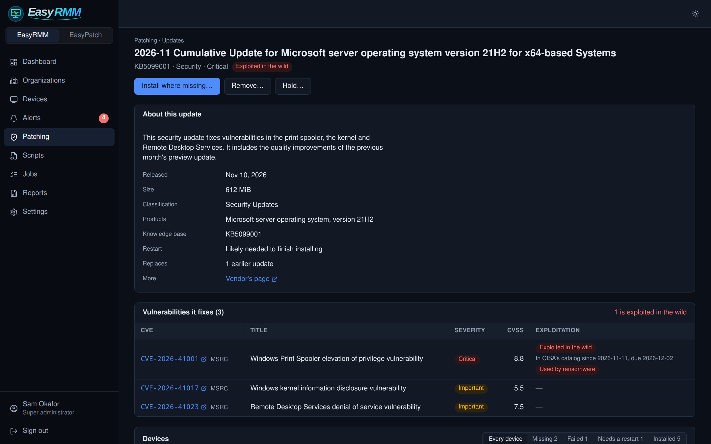
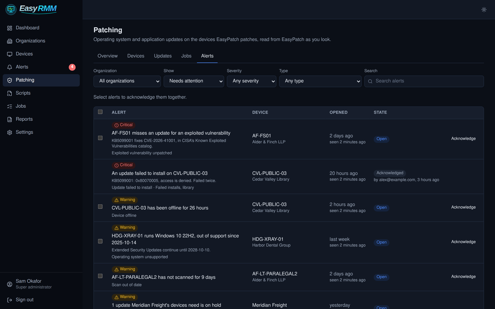
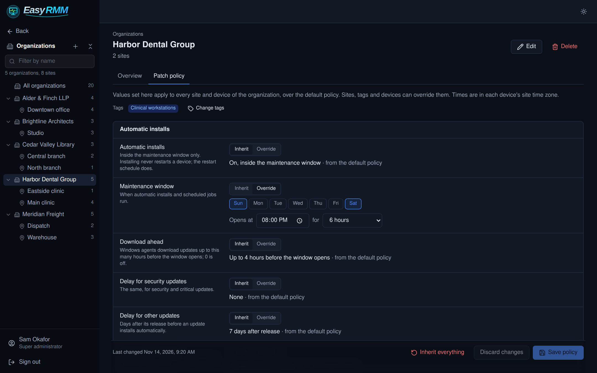
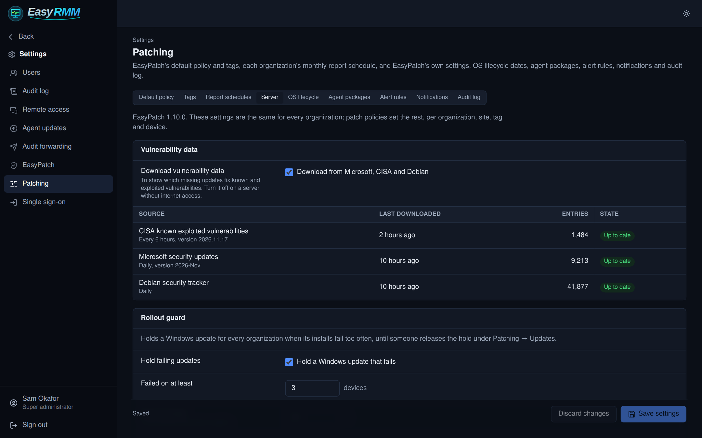

# Patching

EasyRMM patches Windows and Linux devices with its built-in patching
engine, EasyPatch's server, built from `easypatch/`. The engine keeps the
update catalogue, each device's update state, the policies and maintenance
windows, and runs the scans and installs through the EasyPatch agent on
each device. EasyRMM shows all of it in its own console, behind its own
roles, and calls the engine with a signed statement per request
([ADR-0038](../architecture/adr/0038-statements-to-the-patching-engine.md)).

* How the engine works: [Patching engine](../architecture/patching-engine.md).
* The agent on each device: [The EasyPatch agent](../deployment/patching-agent.md).

## Setting it up

There is nothing to set up: the patching engine runs in every EasyRMM
deployment ([Docker](../deployment/docker.md#patching-engine)), and
EasyRMM calls it on the same server with its own key.

1. **Organizations follow EasyRMM's.** Every organization and site has its
   own in the engine, created, renamed and archived with EasyRMM's (see
   [Organizations in the engine](#organizations-in-the-engine)).
2. **Devices get the EasyPatch agent.** Automatic installs are on for every
   organization: within minutes of a device's EasyRMM agent enrolling,
   EasyRMM installs the EasyPatch agent on it (see
   [Installing the EasyPatch agent](#installing-the-easypatch-agent)).
3. **Devices link themselves.** The EasyRMM agent asks the EasyPatch agent
   on the device who it is (`status --json`) and reports it with its
   inventory, at start and then hourly. Within a minute of that report
   EasyRMM checks with the engine that the endpoint really is this device,
   and the device appears in **Patching**.

Endpoints, history and settings of a standalone EasyPatch server can be
brought in, with its agents kept: see
[Importing a standalone EasyPatch](import-easypatch.md).

**Settings → Patching engine** shows the engine's version and state;
*Check now* shows whether it accepts EasyRMM's key.

### Organizations in the engine

Every EasyRMM organization and site has its own in the engine, and EasyRMM
keeps them the same
([ADR-0040](../architecture/adr/0040-one-set-of-organizations.md)):

* **Created** with EasyRMM's name and the organization's **time zone**
  (Organizations → edit; the engine's monthly reports use it), with
  automatic installs of the EasyPatch agent on. An engine organization
  with exactly the same name that nothing links yet is used instead of a
  new one.
* **Renamed** and given a new time zone when EasyRMM's changes. A name
  another engine organization already holds, in another case or archived,
  gets the first 8 characters of EasyRMM's id, as in `Acme (1a2b3c4d)`. It
  gets its plain name back when that is free.
* **Archived** when deleted in EasyRMM, renamed `… (deleted 2026-11-18
  1a2b3c4d)` so that the name can be used again. Endpoints stay in an
  archived organization. An agent EasyRMM did not remove itself keeps
  checking in until it is revoked in the engine.
* **Put back** when anything but EasyRMM archives or deletes them in the
  engine. Descriptions, notes and addresses kept there stay.

This happens as soon as an organization or site changes, and the whole set
is compared every 5 minutes. If the engine is unavailable or refuses a
change, EasyRMM tries again every minute. **Settings → Patching engine**
shows when the engine was last in step, what it could not do, and how many
archives and agent removals are waiting. Organizations are not linked by
hand there.

## Installing the EasyPatch agent

The EasyRMM agent can install the EasyPatch agent on Windows and Linux
devices (x64 and arm64) that have none, and enroll it in the engine's
organization that belongs to the device's organization. The design is in
[ADR-0031](../architecture/adr/0031-easypatch-agent-install.md); what the
agent installs on a device, and how to troubleshoot it, is in
[The EasyPatch agent](../deployment/patching-agent.md).

* **Chosen devices**: in **Patching**, choose devices marked *No EasyPatch
  agent* and **Install EasyPatch agent…**; or on a device's **Patches** tab,
  **Install EasyPatch agent…**. Needs `patch.manage`.
* **A whole organization**: **Settings → Patching engine** → Organizations,
  **Install automatically**. Needs `settings.manage`. Every
  minute EasyRMM looks for devices in that organization with no EasyPatch
  agent, new ones included, and installs it. A failed automatic install is
  tried again an hour later, three times in all; after that, start it by
  hand.

What happens:

1. At its next check-in (within a minute) the device's EasyRMM agent gets a
   signed instruction, valid for 15 minutes. It carries the engine's address
   (EasyRMM's own), EasyRMM's certificate authority when EasyRMM made its
   own certificate, the newest EasyPatch agent package for the device, and
   an enrollment token. EasyRMM creates that token in the engine for this
   one install: single use, valid for an hour, for the engine's organization
   and site EasyRMM created for the device's. The token is never stored,
   and is revoked if the install fails.
2. The agent downloads the package from the engine, checks its size and
   SHA-256 against the engine's list, installs it (`msiexec` on Windows,
   `apt-get` or `dnf` on Linux) and enrolls it.
3. It reports the result with its next heartbeat. The EasyPatch agent shows
   up in the next inventory, and the device links itself as above.

**Patching** and the device's **Patches** tab show where each install is:
waiting for the device, installing, installed, or failed with the reason
(installer and enrollment exit codes are put into words). An install the
agent never acknowledges fails after three minutes; one it does not finish
reporting within 30 minutes fails then.

EasyRMM never installs a second EasyPatch agent: a device whose EasyRMM
agent reports one, in any state and enrolled with any server, is left
alone, and the agent checks again just before it installs. It never
re-enrolls (`--force`) or upgrades the EasyPatch agent either; the agent
updates itself from the engine. EasyRMM removes one only as described in
[Stopping patching for a device](#stopping-patching-for-a-device) and
[Devices that move or are deleted](#devices-that-move-or-are-deleted).

Requirements:

* An EasyRMM agent that reports the EasyPatch agent's install state. An
  older one waits, with a note, until it updates.
* **Linux**: systemd, and apt-get or dnf. If EasyRMM's certificate comes
  from its own authority (`EASYRMM_TLS_MODE=internal`), EasyRMM gives it to
  the EasyPatch agent at enrollment (`--server-ca`), which trusts it for
  EasyRMM's address only. An EasyPatch agent too old for that option trusts
  only the device's certificate store: EasyRMM then enrolls it without it,
  and you add the authority to the store first
  (`/usr/local/share/ca-certificates` and `update-ca-certificates`, or
  `/etc/pki/ca-trust/source/anchors` and `update-ca-trust`). EasyRMM does not
  change the store.
* **Windows**: nothing more; the MSI is given the CA certificate
  (`SERVERCACERT`), and trusts it for EasyRMM's address only.
* One install at a time per device, for at most 20 minutes. An EasyRMM
  agent update waits for it.

## Stopping patching for a device

On a device's **Patches** tab, **Stop patching…** (needs `patch.manage`):

* EasyRMM drops any install of the EasyPatch agent that is waiting, and
  never installs it on the device again, automatically or by hand.
* If EasyRMM linked the device's EasyPatch agent, it sends the agent an
  uninstall job, as below. An agent EasyRMM has not confirmed as one it
  manages (enrolled with another server, say) stays installed.
* It is refused while the agent is being installed. Wait for the install to
  finish, then stop patching.

**Allow patching again** on the same tab undoes it. A removal not sent yet
is cancelled. With automatic installs on, the agent is installed again
within a minute. Otherwise, install it by hand.

## Devices that move or are deleted

* **Deleted in EasyRMM:** the device's EasyPatch agent is uninstalled. The
  removal is cancelled if another EasyRMM device links or reports the same
  endpoint, as after two device records are merged.
* **Moved to another site** of its organization: its endpoint moves to that
  site.
* **Moved to another organization:** an endpoint cannot change
  organization in the engine. EasyRMM has the old agent uninstall itself.
  When it is gone, automatic installs enroll it again in the new
  organization. The device's Patches tab says so in the meantime.

EasyRMM's console has no screen to move or retire a device yet; this covers
devices merged by EasyRMM and moves made through the API.

**How an agent is removed:** EasyRMM sends the engine an `uninstall-agent`
job and checks every 5 minutes. A failed or expired job is sent again. The
agent is gone when the engine no longer shows its endpoint as active. If it
is not gone within 7 days, or is too old to uninstall itself, EasyRMM
revokes the endpoint, and the engine stops serving it.

## When a device is not linked

EasyRMM links a device only when everything agrees, and otherwise says why
(**Settings → Patching engine** → Devices not linked, and the device's
Patches tab). The checks are in
[Device links](../architecture/patching-engine.md#device-links).

| Reason | What to do |
|---|---|
| The EasyPatch agent is not enrolled and active | Check it on the device: `sudo /opt/easypatch/easypatch-agent status` on Linux, `& "$env:ProgramFiles\EasyPatch Agent\EasyPatch.Agent.exe" status` on Windows ([Troubleshooting](../deployment/patching-agent.md#troubleshooting)) |
| The agent is enrolled with another server | The device belongs to another EasyPatch server; import that server's data (see [Setting it up](#setting-it-up)) or re-enroll the agent with this deployment |
| The organization has no patching organization yet | EasyRMM is still creating it, within a minute; **Settings → Patching engine** says why if it cannot |
| The engine has no such endpoint | The agent's endpoint was deleted in the engine; re-enroll the EasyPatch agent |
| The endpoint belongs to another organization in the engine | Endpoints move within an organization only. For a device that moved, EasyRMM has the old agent uninstall itself and, with automatic installs, enrolls it again in the new organization (see *Moved to another organization* above). An agent from an [imported EasyPatch](import-easypatch.md) is left alone, to keep its history: enroll the device's EasyRMM agent in the organization that matches the endpoint's |
| The endpoint is revoked or decommissioned in the engine | Re-enroll the EasyPatch agent |
| The key fingerprint is not one of the endpoint's credentials | The endpoint id was copied from another machine, or its credential was revoked; re-enroll |
| Host names or serial numbers differ | The endpoint is another machine; re-enroll the EasyPatch agent on this one |
| Another device is already linked to the endpoint | Two EasyRMM devices claim one endpoint (a cloned disk, a reinstall). Retire the stale device in EasyRMM |

Refused devices are checked again every 15 minutes, and any device as soon
as its report changes; linked devices are checked again every six hours.

## Patching

**Patching** in the main menu opens on its **Overview**, with **Devices**,
**Updates** and **Jobs** beside it. Each tab keeps its own filters; the
organization chosen carries over.

### Overview

<picture><source media="(prefers-color-scheme: light)" srcset="../images/patching-overview-light.png"></picture>

The overview counts the devices you can see, as the engine last reported
them, and refreshes every minute:

* **Up to date**: the share of devices the engine reports on that are up
  to date, a bar of how the rest stand, and each status with its count,
  linked to the device list filtered to it. Devices not patched from
  EasyRMM are counted beside it, not in it.
* **Needs attention**, worst first, only what has a count: open patching
  alerts (linked to [Alerts](#alerts); acknowledged ones are not counted),
  devices missing updates for vulnerabilities exploited in the wild
  (linked to those updates), devices with failed updates, devices missing
  required updates, devices waiting for a restart, scans out of date or
  never run, EasyPatch agents out of date or offline, devices not patched
  from EasyRMM, the engine's endpoints with no EasyRMM device, and patch
  jobs queued or running.
* **Organizations, least up to date first**, when there is more than one:
  the share up to date, devices, devices missing required updates, with
  failed updates and missing updates for exploited vulnerabilities.
* **In the patching engine, with no EasyRMM device**: endpoints of linked
  organizations that no EasyRMM device is linked to, so they show nowhere
  else. Install EasyRMM's agent on each machine in the same organization:
  EasyRMM links the device to the EasyPatch agent already there when their
  host names match, and the device's Patches tab says why when it cannot.
  Only organizations whose whole you can see are listed; site-level roles do
  not see this list. **Remove** takes out an endpoint whose computer is gone:
  its EasyPatch agent uninstalls itself when it next checks in, and the
  engine stops patching the endpoint then, or after 7 days if it does not
  ([Removing a device](../deployment/agents.md#removing-a-device)).

#### Patch all, Schedule restart all, Update all now

Choose an organization, and a site if you like, and the overview names it,
how many of its devices can be patched from EasyRMM and how many are left
out. With `patch.manage` there it offers:

* **Patch all…**: an install on every device there that has a linked
  EasyPatch agent, whose patching is not stopped and that you may patch.
  The dialog says how many devices, on which platforms (untick one to leave
  its devices out), and how many are left out and why: you may not patch
  them, patching is stopped, no EasyPatch agent, or an agent EasyRMM has not
  linked. Devices you cannot see are not counted. Install what each
  device's policy allows or every available update (below), now or at a
  time, and choose whether devices restart afterwards
  ([Restart after the install](#restart-after-the-install)).
* **Schedule restart all…**: the restart dialog for every such device, only
  where a restart is pending and at a time by default. Servers restart only
  when ticked by name; the others are left out and the result names them.
* **Update all now…**, with a site chosen, and on the site's page: the
  install dialog with its presets, now, every available update, and a
  restart if the updates need it with a countdown. Windows devices are
  included; tick **Linux devices** to add them. One confirmation sends it,
  and every preset can be changed first.

The organization's page has **Patch all…**, and a site's **Update all
now…**.

"Every device" is read when you confirm, not when the dialog opened: a
device enrolled in between is included, and the result gives the counts as
sent. An install of what each policy allows goes to the engine 1,000
devices at a time, however many there are; the result lists each batch, and
a batch the engine refuses or does not answer is reported device by device
(refused: not sent; no answer: not known, check [Jobs](#jobs) before
sending it again) while the next still goes.

**Every available update** is each update the engine reports missing or
failed on the device, except those excluded on it, held, and application
updates the policy does not approve. Updates still in the policy's rollout
delay and drivers are included. Feature upgrades (a new version of
Windows) are left out unless you tick them. Before you confirm, the dialog
reads every device and says what would install, by category, and what is
left out: how many excluded updates (with the devices that have them,
linked to their updates), held, not approved, and devices whose updates
could not be read.

### Devices

The **Devices** tab lists the devices of linked organizations and every
device with an EasyPatch agent:

* **Status** is the device's compliance: up to date, updates missing,
  updates failed, restart needed, scan out of date, never scanned. Devices
  not patched from EasyRMM show why.
* **Missing** counts updates not yet installed (and how many are
  required), failed ones, and those that fix vulnerabilities exploited in
  the wild.
* Filters: organization, site, device group, status, name.

Choose devices to **Scan** them, **Install updates…** (every update the
device's patch policy allows, restarting afterwards if you choose: see
[Restart after the install](#restart-after-the-install)) or **Restart…**
them (see [Restarts](#restarts)). The jobs that carry this out are on the
[Jobs](#jobs) tab.

A device's **Patches** tab shows:

* its status, the job it is working on, and a pending restart with what it
  is for: the updates waiting for it, Windows servicing packages and the
  files Windows will change;
* on Windows, who is signed in and whether the EasyPatch icon is running in
  their sessions;
* the EasyPatch agent's version, and whether it can update itself;
* updates to install, installed updates, the device's update history and
  its jobs;
* **Policy**: every value of the patch policy that applies, with the
  layer that set it (the default policy, the organization, the site, a tag
  or the device), and on Windows the Windows Update settings with how the
  device applied them.

Choose updates to install only those. Before an install on one device, the
dialog shows what the engine would install from the last scan, its size,
how many updates are likely to need a restart, and which updates it leaves
out and why (excluded, not in the policy's categories, on hold…). The
agent scans again before installing.

Scans and installs start when the device next checks in with the engine
(every minute by default). Updates that need a restart finish at the next
restart.

### Updates across devices

The **Updates** tab lists every update the devices in view report, counted
across them: how many miss it, failed it, wait for a restart after it, have
it installed or have it excluded. By default it lists updates some device
still needs, those fixing vulnerabilities exploited in the wild first;
filter by organization, site, category, the state devices are in, or
exploitation, search by title, KB or package, and order by the most
missing, failed or installed.

The engine counts updates over whole organizations or one site. Someone
whose role covers single sites of an organization chooses one of them.

<picture><source media="(prefers-color-scheme: light)" srcset="../images/patching-update-light.png"></picture>

An update's page shows what it is (release date, size, classification,
products, KB articles, the package and its advisories, whether it is likely
to need a restart, what it replaces, the vendor's page), the vulnerabilities
it fixes with CVSS scores and exploitation (CISA's Known Exploited
Vulnerabilities catalog, with its due date and ransomware use, or
Microsoft's report), its holds, and the devices reporting it, filtered by
state. Devices open their Patches tab; an endpoint with no EasyRMM device
is shown as such.

* **Install** on the devices chosen, or **Install where missing…** on every
  device in view where it is missing or failed, except where it is excluded.
  It is installed whatever its category, also when it is on hold.
  Endpoints with no EasyRMM device are left out; devices where you may not
  install are listed afterwards.
* **Remove…** uninstalls it from every device in view where it is installed
  or waits for a restart, as **Remove…** on a device's Patches tab does, and
  excludes it there unless you untick it. Only Windows updates are removed;
  the engine refuses Linux and macOS devices, and each is listed afterwards.
  Packages and applications are not offered for removal.

### Holds

**Hold…** keeps an update out of scheduled installs and installs of every
missing update, in one organization or, for super administrators, in every
organization, until the hold is released. A hold needs a reason, shown
with it. Installing a held update by hand, on its page or on a device,
still installs it. The engine also holds an update itself when it fails on
too many of the devices it was tried on (its rollout guard); such holds
say so.

**Release hold** lifts it. Holds in an organization are placed and released
with `patch.configure` there; holds in every organization only by super
administrators. A second hold in the same place is refused.

### Jobs

The **Jobs** tab lists the patch jobs of the devices you can see:
**Still running** by default, refreshing every few seconds while any is,
or **All recent**. Filter by organization and type; all recent jobs also by
status, how they started (by hand, on a schedule, or by the patching
engine) and when they were requested (the last 24 hours, 7 days or 30
days). The tab shows the newest 200 jobs that match and says when older
ones are left out; narrow the filters to find them.

Open a job for its updates, events and progress: when it was requested and
by whom (or how it started), when a scheduled job starts, until when a
queued job waits for its device, when it was sent to the device (and how
many times), started and finished, and the job it runs again when it is a
retry. A running job can be cancelled; until the device stops, the job says
the cancellation was asked for. A job whose device stopped reporting says
it ran out of time. An install asked to restart its device afterwards shows
that choice and what became of it, linked to the restart; that restart
links back to its install. A job that failed, was cancelled or expired, or left
some updates uninstalled, can be run again with **Retry**; the new job
opens in its place. A retry is refused while the same job is already
queued.

### Alerts

<picture><source media="(prefers-color-scheme: light)" srcset="../images/patching-alerts-light.png"></picture>

The engine checks its alert rules every 2 minutes and opens an alert for
each device, or organization, a rule matches: a device offline, an update
that failed to install, a security update missing some days after it
became required, a scan out of date, a restart waiting some days, an
operating system out of support or near its end (by the
[OS lifecycle](#engine-settings)), an update for an exploited
vulnerability missing, or an update on hold. It resolves an alert
itself once its cause is gone; when the cause comes back within an hour it
opens the same alert again, and after that a new one.
These are patching alerts; EasyRMM's own alerts (disk space, a device
offline to EasyRMM's agent) are under **Alerts** in the main menu.

The **Alerts** tab lists those needing attention (open and acknowledged),
the most severe first, then the newest; show only open, acknowledged or
resolved ones, or all of them, and filter by organization, severity, type
of rule and words in the alert. Each alert shows its device, linked to the
device's Patches tab, or, for an organization's own alert (agents waiting
for approval, an update on hold), the organization; an endpoint with no
EasyRMM device shows its host name. You see the alerts of the devices
whose patching you see; an organization's own alerts, and those of
endpoints with no EasyRMM device, only when you see the whole
organization. `?deviceId=` shows one device's alerts.

**Acknowledge** says someone is on it: the alert stays until the engine
resolves it, shows who acknowledged it and when, and is no longer counted
on the overview. Select several to acknowledge them together. You can
acknowledge an open alert of a device you manage patching for
(`patch.manage` at its site), and an organization's own alert when you
manage patching for the whole organization. An alert someone else
acknowledged, or that resolved, meanwhile is left as it is, and EasyRMM
says how many it acknowledged.

The API: `GET /api/v1/patching/alerts` with `organizationId`, `deviceId`,
`status` (`unresolved`, the default, `open`, `acknowledged`, `resolved` or
`all`), `severity` (`Critical`, `Warning`, `Info`), `ruleType` and
`search`; `GET /api/v1/patching/alerts/summary` with `organizationId` (open
and acknowledged counts, and the unresolved by severity); and
`POST /api/v1/patching/alerts/acknowledge` with `alertIds`, which answers
how many it acknowledged.

### Excluding and removing updates

**Exclude…** on an update to install keeps it off this device: it is
installed neither automatically nor with every update, and it no longer
counts against the device's status. For a Linux package, only that version
is excluded; a newer version is a new update. **Include** undoes it. An
update excluded by the policy's excluded KBs is marked so and cannot be
included on one device.

**Remove…** uninstalls an installed Windows update, also one waiting for
its restart, when the device's agent can (EasyPatch agent capability
`uninstall-updates`). The agent uses Windows Update's uninstall where the
update allows it and DISM otherwise, and never restarts the computer: when
Windows needs a restart to finish, the job says so. Some updates cannot be
removed, such as servicing stack updates; the job then fails and nothing
changes. Removing also excludes the update on the device unless you untick
it. Linux packages are not removed this way.

### Messages to users

**Message users…** shows a preset message to the people signed in to a
Windows device, from the EasyPatch icon: updates are installing, updates
installed, a restart is needed, save your work, maintenance tonight, or a
restart at a time you choose. Only these messages can be sent. A message
only names a restart time; **Restart…** restarts the device. The engine
refuses messages to Linux and macOS devices, and to agents without the
icon.

### The EasyPatch agent

The agent row says whether a newer agent is available and whether the
policy lets agents update themselves. **Update agent…** has it update now:
at its next check-in it downloads the newest package the engine holds,
checks its release signature and installs it. An agent built without a
release key cannot update itself, and the engine refuses to update it;
reinstall it once
([Updating the agent](../deployment/patching-agent.md#updating-the-agent)).

### Restarts

**Restart…** is on a device's Patches tab when a restart is pending or the
device's EasyPatch agent can restart the computer, and for chosen devices
on the Patching page. The dialog first asks the engine what the restart
would do, and lists the devices that will not restart and why: no restart
is pending, the EasyPatch agent cannot restart the computer (update the
agent), the engine no longer lists the device's endpoint, or the device is
not linked.

* **Only if a restart is pending** is ticked when any chosen device reports
  one: a device then restarts only if a restart is still pending when the
  job runs. Untick it to restart every chosen device, whatever it reports,
  at most 100 at once; EasyRMM then reads each one from the engine to tell
  servers apart and to check that its agent can restart the computer.
* **Signed-in users** are treated in one of four ways:

  | Choice | What the people signed in see |
  |---|---|
  | Count down, then restart (5 minutes by default; 1 to 60) | A countdown; they can only restart sooner |
  | Ask users, with a deadline (4 hours by default; 15 minutes to 7 days) | They restart now or postpone, never past the deadline; then a five-minute countdown |
  | Ask users, no deadline | They choose when; the restart fails if nobody agrees within 7 days |
  | Restart at once | Nothing: it restarts without warning |

  A computer nobody is signed in to restarts at once, whatever the choice.
  Without the EasyPatch icon (Linux and macOS agents, or Windows where the
  icon is not running) the operating system warns instead: a countdown
  uses its own shutdown warning (on Linux, the messages of
  `shutdown -r`), a restart with a deadline waits for the deadline, and one
  without a deadline waits for the icon and fails after 7 days.
* **When**: now, or at a time up to 31 days ahead. A device that is offline
  then gets from 15 minutes to 24 hours to come back (two hours by
  default); otherwise its restart is dropped.
* **Servers restart only when you tick them**, by name, one by one or all
  at once.
* A device runs one job at a time, so a restart never starts in the
  middle of an install.

Recurring restarts are part of the patch policy (below).

#### Restart after the install

The install dialog, wherever it opens, asks what happens once the updates
are installed:

* **Don't restart** (the default).
* **Restart if the updates need it**: once the install has finished, the
  device restarts when its updates need it, or it has a restart pending; its
  agent checks again before restarting.
* **Restart when done**: once the install has finished, the device
  restarts, at most 100 devices at once.

With either restart, choose how signed-in users are treated, as for any
restart (a countdown by default). The dialog first reads each device from
the engine: servers restart only when ticked by name, and an unticked
server installs and is not restarted.

The engine cannot restart a computer when an install ends, so EasyRMM does:
every minute it reads each install it waits for, and asks the engine for
the restart once the install has **completed** (some updates may have
failed). **A failed, cancelled or expired install never restarts the
device.** An install that waits for a restart to go on gets one then, and
the last when it has finished. The choice is kept in EasyRMM's database: a
restart of EasyRMM's server neither loses it nor asks for it twice. EasyRMM
reads the device again first and does not restart it if it became a server
nobody ticked, its agent cannot restart, its patching was stopped or its
EasyPatch agent changed; the install's job says so. It stops waiting for an
install that has not ended within 40 days.

### Policies

<picture><source media="(prefers-color-scheme: light)" srcset="../images/patch-policy-light.png"></picture>

A patch policy says when devices scan and install, what they install and
how computers restart. It is set in layers, each overriding the ones above
it:

| Layer | Where | Who changes it |
|---|---|---|
| Built-in defaults | Built into the engine | Nobody |
| Default policy | Settings → **Patching** | Super administrators |
| An organization | The organization's **Patch policy** tab | `patch.configure` in the organization |
| A site | The site's **Patch policy** tab | `patch.configure` in its organization |
| A tag | Settings → **Patching** → Tags, the tag's policy | Super administrators |
| A device | Its Patches tab → Policy → **Set values for this device** | `patch.configure` in its organization |

A device with several tags that set the same value takes it from the tag
with the highest priority. A device's **Policy** view shows the policy in
effect, each value with the layer it comes from.

Each value of a layer is **Inherit**, shown with where it comes from (for
example *Every 12 hours · from the organization*), or **Override**. Saving
keeps exactly the values overridden at that layer. **Inherit everything**
clears a layer; on the default policy, **Restore built-in defaults** puts
the built-in values back. Both ask you to type the layer's name. Anyone who
sees patching in an organization sees its policies; tags' policies need
`patch.view` everywhere.

A policy holds:

* **Automatic installs**: on or off; the maintenance window (days, start and
  length), the only time updates install automatically; on Windows,
  downloading up to 24 hours ahead; how many days to wait before installing
  security updates (0 to 90) and others (0 to 365); and whether updates
  fixing known-exploited vulnerabilities skip the wait.
* **What installs**: categories (security, critical, cumulative, definition,
  servicing stack, .NET, feature, driver, other), optional updates,
  accepting licence terms, and KBs never to install.
* **Application updates** (Windows): winget packages, by ID, updated in the
  maintenance window.
* **Restarts and users**: a recurring restart, with the same choices as
  **Restart…**; on Windows, the EasyPatch icon and install notifications;
  and EasyPatch agent updates.
* **Agent schedule**: how often the agent checks in, scans and sends its
  inventory, the spread around those times, when a scan counts as out of
  date, and how many devices of a site install at once (set on the default
  policy, an organization or a site).
* **Windows Update settings** (Windows): Automatic Updates, feature updates,
  quality updates and pausing, and restart behaviour. Each group is
  **Inherit**, **Leave alone** (Windows keeps its own settings, even where
  a layer above manages them) or **Manage**.

Sections for Windows only are not shown for Linux and macOS devices. Times
are in the site's time zone; on the default policy, an organization or a
tag, in each device's site's.

EasyRMM checks a policy as the engine does before saving it, and refuses two
things that would stop patching without saying so: no category to install,
and a layer that turns automatic installs on, or changes the window, with
no maintenance window left. A tag that turns automatic installs on sets its
own window.

### Application updates (winget)

The policy's **Application updates** section (Windows) keeps approved
third-party applications up to date with
[winget](https://learn.microsoft.com/windows/package-manager/winget/). It
is off by default. Tick **Keep the approved applications up to date** and
list the applications under **Approved applications** by winget package ID,
such as `Mozilla.Firefox` (run `winget search <name>` on any Windows
computer and use the *Id* column); at most 100. A level that sets its own
list replaces the inherited one; lists are not merged. A tag policy is a
convenient way to try it on a pilot group first.

* **What is updated.** Only approved applications that are already
  installed on the computer, to the version the winget community repository
  offers, never the Microsoft Store. Nothing is installed new, downgraded
  or removed. Applications installed for one user only (in `AppData`, as
  many browsers do by default) are not seen.
* **When.** The agent checks the approved applications after each Windows
  Update scan. Application updates appear with the others in the
  **Application** category and install with them: in the maintenance
  window, with every update, or chosen by hand. Approved ones count as
  required, with the delay for other updates; they carry no CVE data.
* **Verified.** An upgrade counts only when winget lists the new version
  afterwards.
* **Agreements and restarts.** Approving an application accepts its
  package agreements; the policy's *License agreements* applies to Windows
  updates only. The agent never restarts for an application update. When
  the installer needs a restart and winget already lists the new version,
  the update counts as installed and the job says a restart is needed;
  when the new version is not listed yet, the update fails with that reason
  and the next check after a restart confirms it. A third-party installer
  can still restart the computer by itself; approve only applications
  whose installers behave well.
* **Removed from the list.** The agent stops checking it, and its updates
  become not applicable at the next scan.

The agent installs winget itself where it is missing
([winget](../deployment/patching-agent.md#winget)). Windows Server 2016
cannot run winget.

**Application updates or the Software tab.** Both can update applications
with winget. The policy's application updates are how applications are kept
up to date on a schedule: the listed packages are updated in the
maintenance window, like the rest of the policy. A device's **Software** tab
and Jobs → **Install software**
([ADR-0028](../architecture/adr/0028-software-deployment.md)) are one-off
actions that run when you ask, without waiting for the window. The policy
editor says so and links to Jobs.

### Tags

Tags group devices across organizations (a pilot ring, servers) so one
policy applies to all of them. Super administrators add, change and delete
them under Settings → **Patching** → Tags: a name, a colour, a priority from
0 to 1000 and a description; deleting one asks for its name. **Change
tags** on an organization's, site's or device's page gives it tags, at most
20, for super administrators. A device also has its site's and
organization's tags, shown with a dashed outline. Others with patching see
the tags in use in their organizations.

### Reports

**Reports** in the main menu has three patch reports
([Reports](reports.md#patch-reports)): **Patch compliance**, each device's
patching as the engine last saw it, with the organizations' compliance
trend over 30 or 90 days or a year; **Patch installations**, what patch
jobs installed, failed to install, skipped or cancelled; and **Monthly
patch reports**, a PDF of an organization's patching over a month.

A monthly report covers an organization: its compliance, what was
installed and what failed over the month, and, with **List each device**, a
page per device. **Make a report** makes one for a past month, or for the
current month so far, at most 10 years back. **PDF** downloads it; **Email**
sends it as an attachment to the addresses given, or, left empty, to the
organization's schedule's recipients (at most 20); the bin deletes it. A
report larger than 15 MB cannot be emailed. The list shows the newest 200
reports; choose an organization to see its own.

Settings → **Patching** → **Report schedules** sets, for each organization,
a day of the month (1 to 28) on which the engine makes the report of the
month before, in the organization's time zone, and emails it to the
schedule's recipients. A schedule that is on needs at least one recipient.
Reports made on a schedule are listed with the others, marked
*Scheduled*, with whether the email was sent.

**Where email comes from.** EasyRMM gives the engine its own mail server,
the one that also sends invitations and password resets: the console's
(Settings → **Notifications** → Mail server) or `.env`'s `EASYRMM_SMTP_*`
settings, which win when `EASYRMM_SMTP_HOST` is set ([Mail](mail.md)). It
gives it at start and again at once after every change, without a restart.
Without a mail server, **Email** and schedules say that EasyRMM has no mail
server to send reports with. The engine sends reports only over STARTTLS
or TLS, so a mail server without encryption is refused for reports.

### Engine settings

Settings → **Patching** has more views, of the engine's settings that are
the same for every organization. Those with `patch.configure` see the
first four, and super administrators change them; alert rules and
notifications are for super administrators only, as they reach every
organization.

* **Server**: the engine's version and its server settings.
  *Vulnerability data*: whether the engine downloads CISA's known exploited
  vulnerabilities (every 6 hours), Microsoft's security updates and the
  Debian security tracker (daily), with each feed's last download, its
  entries and its last error; turn it off on a server without internet
  access. *Rollout guard*: whether a Windows update is held for every
  organization once it failed on at least so many devices and so many
  percent of those that tried it, over so many days; the hold is released
  under Patching → Updates. *Monthly reports*: the "Prepared by"
  line (at most 100 characters; empty leaves it out) and how many months
  reports are kept. *Jobs*: installs at once across the server, when a job
  not started expires, when a running one fails, how long one waits for a
  restart, how long an agent has to start a job before it is offered again
  and how many offers before it fails. *Agents*: when a device counts as
  offline, how long agent credentials last and how many days before they
  expire agents renew them (fewer than they last). *Keep for*: how long
  the engine keeps device events (with resolved alerts and notifications),
  its audit log (with the daily compliance records), finished jobs, scan
  results and update history; it deletes older records every 6 hours.
  EasyRMM checks each value against the engine's bounds before saving and
  saves only what changed.
* **OS lifecycle**: when each operating system build stops getting
  security updates, and, where there are any, when paid extended security
  updates end. The engine matches a Windows device by product (Windows 10,
  Windows 11, Windows Server), edition group (Home and Pro, Enterprise and
  Education, Enterprise LTSC, IoT Enterprise LTSC, Server, or Any edition
  as a fallback) and build, and a Linux device by distribution and release
  (Ubuntu's year and month, as 2404; the major version for the others). A
  device whose build has no entry shows its support as unknown. The engine
  comes with entries for the current releases; add one for each new
  release (a new Fedora every six months, for instance) and check the
  dates against the vendor's lifecycle pages. Each product, edition and
  build has one entry.
* **Agent packages**: the EasyPatch agent packages that come with the
  engine, with their version, system, architecture, size, SHA-256 and
  release signature, and a download link on EasyRMM's own address.
  EasyRMM's agent installs the newest package for a device
  ([above](#installing-the-easypatch-agent)), and agents update themselves
  to them ([Updating the agent](../deployment/patching-agent.md#updating-the-agent)).
* **Audit log**: the engine's audit log, for those with `audit.view`
  and `patch.view`: what EasyRMM's users did through EasyRMM (named by
  their EasyRMM email) and what the engine did on its own, such as the
  rollout guard holding an update. Organizations and devices carry their
  EasyRMM names and link to them. Filter by organization, area and day (in
  your browser's time zone); 50 entries a page, newest first. You see the
  entries of the organizations whose audit log and patching you see whole;
  entries of no organization (server settings, the OS lifecycle, the
  engine's own tasks) are for those who see every organization.
  EasyRMM's audit log keeps its own record of what is done here.
* **Alert rules** (super administrators): what
  makes the engine raise an [alert](#alerts). It comes with one rule
  of each type. A rule has a name, a type, a severity and, for some types,
  a threshold (a device offline for so many hours, from 1 to 720; a
  security update missing so many days after it became required, from 0
  to 365; a restart waiting so many days, from 1 to 90; an operating
  system whose support ends within so many days, from 0 to 365, 0 meaning
  once it has ended). It covers every organization or one, and, for the
  types that look at devices, every device or those with a tag. It sends
  each new alert to the channels it names (none: Patching → Alerts only),
  again every so many hours while the alert stays open (0, the default,
  sends it once; at most 720), and, when asked, when the alert resolves.
  Turn a rule off to keep it for later. Changing what a rule looks for, or
  where, or turning it off, resolves its open alerts; the next check opens
  again those that still apply. Deleting a rule resolves its alerts. A rule
  for an organization EasyRMM does not link says so and cannot be saved
  until it covers a linked one.
* **Notifications** (super administrators): the
  channels rules send to, and the messages sent.
  *Notification channels*: email (up to 20 recipients) or a webhook
  (`https://` only; Slack, Microsoft Teams Workflows, or generic JSON).
  The engine keeps a webhook's address encrypted and never shows it again,
  only its host: leave the address empty when changing a channel to keep
  it. A generic webhook's messages are signed with HMAC-SHA256 of the body
  in the `X-EasyPatch-Signature` header; its signing key is shown once,
  when the channel is added, and a new one can be made (the old one stops
  working at once). **Send a test** queues a test message (one each 30
  seconds per channel). A channel that is off sends nothing; a type cannot
  change.
  Deleting a channel deletes its messages; rules stop sending to it.
  *Messages* start `[EasyRMM]` (for example `[EasyRMM] Warning: PC-042
  has been offline for over 24 hours`, or `[EasyRMM] 7 new alerts`) and
  link into EasyRMM: an endpoint's alert to its device's **Patches** tab,
  an organization's to **Patching → Alerts** for that organization, and
  the message itself to **Patching → Alerts**. The links go through
  `/go/from-easypatch/…`, which opens Patching with a notice when the
  reader cannot see that device or organization.
  *Email and webhooks*: email channels send through EasyRMM's mail server,
  as monthly reports do ([Where email comes from](#reports)); without one
  they cannot send, and the page says so. Webhooks go to public addresses
  only, unless **Allow webhooks to private network addresses** is on.
  Loopback, link-local and multicast addresses, and the subnets the server
  itself is on, stay blocked even then: the engine shares the host's
  network, so a webhook on the server's own subnet cannot be reached; put
  it behind a router, or use a public address.
  *Messages*: each message to a channel, newest first, with its result and,
  for one that failed, why. The engine tries a failed message again, waiting
  longer each time (1, 2, 4 minutes and so on, up to an hour), and gives up
  on a test after 3 attempts.

<picture><source media="(prefers-color-scheme: light)" srcset="../images/patch-server-settings-light.png"></picture>

The API: `GET` and `PUT /api/v1/patching/settings` (every setting shown
here; the answer adds `feeds`, `version`, `canEdit` and, when it cannot be
changed, `readOnlyReason`); `GET` and `POST /api/v1/patching/lifecycle`,
`PUT` and `DELETE …/{id}`; `GET /api/v1/patching/agent-packages`; and
`GET /api/v1/patching/audit` with `organizationId`, `area` (the start of an
action's name, as `policy.`), `from` and `to` (RFC 3339 instants, `to`
excluded) and `page`. Alert rules: `GET` and `POST
/api/v1/patching/alert-rules` (the list adds the rule `types` with their
thresholds, and the `channels`), `PUT` and `DELETE …/{id}`. Notifications:
`GET /api/v1/patching/notifications` (the channels, the mail server and
`allowPrivateNetworkWebhooks`) and `PUT` with `allowPrivateNetworkWebhooks`;
`POST /api/v1/patching/notifications/channels`, `PUT` and `DELETE …/{id}`,
`POST …/{id}/test` and `POST …/{id}/rotate-secret` (a generic webhook's new
signing key, in `signingSecret`); and
`GET /api/v1/patching/notifications/deliveries` with `channelId`, `status`
(`Pending`, `Sent`, `Failed`) and `page`.

### Scripts that install updates

Scripts in the library that install updates themselves (Windows Update,
`apt upgrade`, `dnf upgrade`…) work around all of this. The script library
warns about them; see
[Scripts and jobs](scripts-and-jobs.md#scripts-that-install-updates).

## Who can do what

| Permission | Allows | Built-in roles |
|---|---|---|
| `patch.view` (with `device.view`) | Patching, a device's Patches tab | Every role |
| `patch.manage` | Scan, install, restart, Patch all, Update all now and Schedule restart all (on the devices where you hold it), cancel, retry, exclude and include updates, remove an update, install or remove an update across devices, message users, install and update the EasyPatch agent, stop and allow patching for a device | Technician and above |
| `patch.configure` | Change the standing rules of patching: the patch policy of the organization, its sites and devices; hold an update in the organization and release its holds (in every organization, the default policy, tags and tags' policies: super administrators only). Only organization-wide roles hold it | Organization administrator and above |
| `report.view` (with `patch.view`) | The patch reports: compliance and installations for the devices you see; the compliance trend, monthly reports and report schedules of organizations you see whole | Every role |
| `report.view` and `patch.manage` over the organization | Make, email and delete its monthly reports | Technician and above, with an organization-wide role |
| `report.view` and `patch.configure` over the organization | Change its report schedule | Organization administrator and above |
| `patch.configure` anywhere | Settings → Patching: the default policy and tags, and the engine's server settings, OS lifecycle and agent packages (changing the server settings and OS lifecycle: super administrators only) | Organization administrator and above |
| `patch.view` (with `device.view`) | Patching → Alerts: the alerts of the devices you see; an organization's own alerts when you see it whole | Every role |
| `patch.manage` | Acknowledge alerts: a device's where you manage its patching, an organization's own when you manage the whole organization | Technician and above |
| `patch.configure` everywhere | Settings → Patching → Alert rules and Notifications | Super administrator |
| `audit.view` and `patch.view` | Settings → Patching → Audit log: the engine's audit log, for organizations you audit whole; with both everywhere, all of it | Organization administrator and above (a site administrator's role does not cover an organization whole) |
| `settings.manage` | Settings → Patching engine, including automatic installs of the EasyPatch agent | Super administrator |

Both are checked at the device's site before the engine is called; a job is
shown only when its device is one you can see. EasyRMM's statement to the
engine carries the role and organizations of that one call, and the engine
checks them again.

## Audit

| Action | Recorded |
|---|---|
| `patch.scan`, `patch.install` | One record per device that started, with the job id; installs record which updates (what each policy allows, every available update with how many, or chosen ones), any scheduled time, a restart afterwards and how, and an install from an update's page its update id. Part of a Patch all: the organization or site, and the request's id |
| `patch.restart` | One record per device that was asked to restart, with the job id, how signed-in users were treated (the countdown or deadline), whether only if a restart is pending or always, how long it waits for an offline device, any scheduled time and the servers you confirmed. A restart after an install is recorded by EasyRMM's patching component, with the install's job and who asked for it |
| `patch.install_all`, `patch.restart_all` | One record per Patch all, Update all now or Schedule restart all, for the organization or site: how many devices it reached, succeeded and failed, how many were left out and why, the platforms, each batch sent to the engine, the presets (updates, feature upgrades, time, restart afterwards) and, for a restart, the servers left out |
| `patch.cancel` | The job and its device |
| `patch.exclude`, `patch.include` | The update excluded on the device, or included again, and the reason given |
| `patch.remove_update` | The update, the removal job, and whether it was excluded too, with the reason; from an update's page, one record per device |
| `patch.hold`, `patch.release_hold` | The update, the reason and where it is held: the organization, or every organization |
| `patch.notify` | One record per device messaged: the message, and the restart time it names |
| `patch.agent_update` | One record per device whose agent was asked to update, with the job id |
| `patch.retry` | The job retried, the new job and the device |
| `patch.policy_update`, `patch.policy_reset` | The layer (default, organization, site, tag or device) and its name; for a change, the values changed |
| `patch.tag_create`, `patch.tag_update`, `patch.tag_delete` | The tag's name, colour and priority; a renamed tag's old name; for a deleted one, how many devices had it and whether it had a policy |
| `patch.tag_assign` | The organization, site or device, and the tags given and taken off |
| `patch.report_generate`, `patch.report_download`, `patch.report_send`, `patch.report_delete` | A monthly report made (and whether it lists each device), downloaded, emailed (to how many recipients) or deleted: the organization, the month, whether it was the month so far, and the file |
| `patch.report_schedule` | An organization's report schedule changed: on or off, the day, how many recipients, and whether it lists each device |
| `patch.settings_update` | The engine's server settings changed: each setting changed, from and to. Saving with nothing changed records nothing |
| `patch.lifecycle_create`, `patch.lifecycle_update`, `patch.lifecycle_delete` | An OS lifecycle entry added, changed or deleted: its product, edition group, build, version and dates |
| `patch.alert_acknowledge` | Alerts acknowledged: one record per device (how many, and their titles, at most 20), and one per organization for its own alerts |
| `patch.alert_rule_create`, `patch.alert_rule_update`, `patch.alert_rule_delete` | An alert rule added, changed or deleted: its name, type, severity, threshold, on or off, organization and tag, how many channels, reminders and whether it sends on resolve |
| `patch.channel_create`, `patch.channel_update`, `patch.channel_delete` | A notification channel added, changed or deleted: its name, type, on or off, how many recipients, a webhook's format and host (never its address), and whether the address changed |
| `patch.channel_test`, `patch.channel_rotate_secret` | A test sent to a channel; a webhook's new signing key made (the key is not recorded) |
| `patch.notifications_update` | Webhooks to private networks allowed or blocked, from and to |
| `report.export` | A patch compliance or installations CSV downloaded, with its filters and rows, as for every report |
| `patch.agent_install` | One record per device an EasyPatch agent install was requested for. Automatic installs are covered by the record of turning them on |
| `easypatch.organization_update` | **Install automatically** turned on or off, and for which organization |
| `patch.stop`, `patch.allow` | Patching stopped or allowed again for a device, by whom |
| `easypatch.organization_create`, `easypatch.organization_adopt`, `easypatch.site_create`, `easypatch.site_adopt` | The engine's organization or site EasyRMM created, or the existing one it took, for which EasyRMM organization or site |
| `easypatch.organization_archive`, `easypatch.site_archive` | An engine organization or site archived because it was deleted in EasyRMM |
| `easypatch.import`, `easypatch.organization_import`, `easypatch.site_import` | A standalone EasyPatch server's data imported: how many organizations and sites were made in EasyRMM or joined EasyRMM's; each organization or site linked, with its name in the engine and in EasyRMM |
| `easypatch.agent_uninstall`, `easypatch.endpoint_revoke`, `easypatch.agent_remove` | An uninstall job sent, an endpoint revoked, and a removal finished, each with the device's host name and why |

The engine records each enrollment token EasyRMM creates against the
EasyRMM user who asked for the install, or EasyRMM for an automatic one.

## Limits

* One patching engine per EasyRMM deployment.
* The device list reads at most 10,000 endpoints per engine organization
  and shows at most 5,000 devices; the job list shows the newest 200 jobs
  that match its filters.
* A restart whether or not a restart is pending reaches at most 100 devices
  at once; one only where a restart is pending, 1,000. So does a restart
  after an install: when done, 100 devices; if the updates need it, 1,000.
* Patch all installing what each policy allows has no device limit: it goes
  to the engine 1,000 devices at a time. Every available update reads each
  device's updates first and reaches at most 1,000 devices; choose a site
  beyond that. At most 1,000 updates install on a device at once; the
  result says when there were more.
* Each minute, EasyRMM reads at most 500 installs waiting to restart their
  device; the rest wait for the next minute.
* The device list is cached for 30 seconds; a scan or install refreshes it.
* An organization, a site or a device has at most 20 tags of its own.
* The patch installations report reads at most 5,000 rows and says so;
  narrow it by organization, site or period. Its periods go back at most a
  year, as does the compliance trend.
* The compliance trend has a point a day: the engine records each
  organization's compliance every 30 minutes and keeps the day's last
  record (by UTC date), for as long as it keeps its audit log (a year by
  default). Days before an organization had endpoints are not counted.
* The update list shows 50 updates a page and an update's page 200 devices
  a page. Installing or removing an update across devices reaches at most
  1,000 devices at once: choose an organization or a site beyond that.
* The overview lists at most 500 endpoints with no EasyRMM device.
* The engine's audit log shows 50 entries a page, up to page 10,000.
* Patching → Alerts shows at most 200 alerts that match, the most severe
  first, and says when there are more; at most 200 are acknowledged at
  once. An organization's alert counts on the overview, for those who see
  only some of its sites, read at most 200 of its alerts and say so.
* An alert rule has a name of at most 100 characters and sends to at most
  20 channels. A channel has a name of at most 100 characters, at most 20
  email recipients, or a webhook address of at most 2,048 characters.
  Messages show 50 a page, up to page 10,000.
* Real email delivery is tested against Mailpit on loopback: the bundle
  test sets it as the mail server in the console and an email channel's
  test arrives. Alerts and reports by email, and webhook delivery, are not
  tested against a mail server or a webhook receiver: the bundle test
  checks that an alert's message is queued, and why it could not be sent
  without a mail server.
* An OS lifecycle entry's product has at most 64 characters, its edition
  group and version 50 and its notes 1,000; builds go from 1 to 1,000,000.
* The EasyPatch Linux agent needs systemd: it runs apt in transient
  systemd units. EasyRMM does not install it where there is none.
* Each minute, EasyRMM moves at most 200 endpoints to their device's site
  and handles at most 100 agent removals; the rest wait for the next
  minute.
* EasyRMM calls the engine on loopback only, over plain HTTP: anything
  else would send its statements across the network (`EASYRMM_PATCHING_URL`
  is refused otherwise).

## Troubleshooting

Problems on a device (enrollment, certificates, Windows Update errors,
agent updates, winget) are in
[The EasyPatch agent](../deployment/patching-agent.md#troubleshooting).
This section covers the engine and its jobs.

### The engine

In the deployment's `deploy/` folder:

```bash
docker compose ps easypatch-api easypatch-worker            # both "running (healthy)"
docker compose ps -a easypatch-db-init easypatch-migrate    # both "exited (0)"
docker compose logs --tail=200 easypatch-api easypatch-worker
curl -s http://127.0.0.1:18180/health/ready                 # on the host
```

The worker's `http://127.0.0.1:18181/health` reports the database and
each background task; a task that has not finished a cycle within three
intervals plus two minutes is stalled. Every engine response carries an
`X-Correlation-ID`, which also appears in its log lines.

| Symptom | Cause and fix |
|---|---|
| `easypatch-db-init` or `easypatch-migrate` exits non-zero | Read its log. `easypatch-db-init` refuses to run while `.env` lacks the engine's database passwords: rerun `deploy/scripts/setup.sh` with its usual options, which adds them |
| `easypatch-api` or `easypatch-worker` never becomes healthy | The database is unreachable (check `postgres`), or `easypatch-migrate` failed; they wait for it |
| `easypatch-api` stops with `EasyRmm:GatewayKey is not base64.` or `… must be at least 32 bytes.` | `EASYRMM_PATCHING_KEY` in `.env` is damaged. Restore it from your backup of `.env`, or empty it and rerun `setup.sh`, which makes a new one; then `docker compose up -d` |
| Patching pages fail and the API log says `Refused a statement from EasyRMM … : bad signature` | EasyRMM's server and the engine do not share the key. After `EASYRMM_PATCHING_KEY` changed, `docker compose up -d` recreates both with it |
| `… expired or not yet valid` in the API log | A request reached the engine more than 5 seconds after its statement expired: a stalled host or a clock jump. If it persists, check the host's time synchronization |
| **Settings → Patching engine** shows the engine failing | The engine is down or refuses EasyRMM's key; *Check now* says which |
| `429 Too Many Requests` | A rate limit: agents behind one NAT address share the per-address limits for enrollment and downloads |
| Disk usage grows | Check *Keep for* under Settings → **Patching** → Server. Container logs rotate at 20 MB × 5 files |

### Jobs

| Symptom | Explanation |
|---|---|
| A job stays queued | A device runs one job at a time. It waits while the device is offline, busy, or has an install waiting for a restart (only scans and inventory run then). Installs also wait for the site's *Installs at once* and the server-wide limit. Unpicked jobs expire (7 days by default) |
| `duplicate_job` | The device already has the same job active; open that one, or cancel it |
| `nothing_to_install` | The last scan shows nothing matching: installed, excluded or no longer offered. Scan first if the data is old |
| A job waits for a restart | Windows needs a restart before it can install the rest. Installing never restarts: use **Restart…** or a restart schedule. With no restart in 30 days the job fails with `reboot_not_performed` |
| A job failed: "did not acknowledge the job" | It was sent 5 times without the agent confirming it. Check the agent's log |
| A job failed after the running timeout | No progress for 12 hours. A late result from the agent still replaces the failure |
| Automatic installs do not run | *Automatic installs* must be on, and jobs are made only while the maintenance window is open. Updates inside their delay ("deferred until") and updates on hold are skipped; a device missing only held updates gets no job |
| No *Download ahead* jobs | They need automatic installs, a maintenance window, a value above 0 and a Windows agent that reports `download-updates`. They are queued within that many hours before the window, not later than 15 minutes before it, and never while it is open |
| Items skipped with `WindowStarted` | The window opened before the download reached them; the installation downloads them. Raise *Download ahead* |
| An update is *On hold*, or skipped with `Held` | Placed by the rollout guard or by someone; its page says why and releases it. Choosing the update on a device installs it anyway |
| A scheduled job cancelled with "Every update in this job was put on hold" | Nothing was installed; it is scheduled again once the hold is released |
| The rollout guard holds too eagerly, or never | Adjust or turn it off under Settings → **Patching** → Server, *Rollout guard*. It counts each device's latest result on Windows devices only, without application updates |
| An update *Offered again* | Windows reported the install as successful, but still offers it (common with KB5007651). It does not count against the device and is not installed again automatically; choose it to retry |
| A removal fails with `update_not_removable` | Windows does not allow it (servicing stack updates, most definition updates). Nothing changed |
| A removal fails with `update_still_installed`, `dism_failed` or a `0x800F…` code | DISM refused or could not finish; the message has its error, the log is `C:\ProgramData\EasyPatch\logs\update-removal.log`. Restart the device and try again |
| A removed update still shows as installed | Windows removes most updates at the next restart; the next scan after it shows the change |
| `agent_upgrade_required` | The device's EasyPatch agent does not support that job; update the agent |

### Alerts, notifications and reports

| Symptom | Cause and fix |
|---|---|
| No alerts appear | Rules are evaluated every two minutes by `easypatch-worker`. Check that the rule is on and covers the organization and tag. Offline devices raise only the offline alert |
| An alert does not resolve | It resolves after two evaluations without a match. *Scan out of date* clears after a successful scan, *Update failed to install* when no failed update is left |
| No email or chat message | The rule needs channels. Then check the channel's last message under Settings → **Patching** → Notifications |
| `A stored notification secret cannot be decrypted` | The worker does not see the engine's keys in `${EASYRMM_DATA_ROOT}/easypatch/keys`. If they were lost, enter the webhook addresses again |
| Webhook refused: private network addresses | Turn on **Allow webhooks to private network addresses** if that is intended |
| Reports are not emailed | EasyRMM has no mail server (Settings → Notifications → Mail server, or `EASYRMM_SMTP_HOST`), or it is used without encryption: reports go only over STARTTLS or TLS. Reports over 15 MB are not emailed |
| A scheduled report was not sent | The schedule must be on with recipients. Months that ended before it was turned on are skipped. Organizations east of UTC wait until the month has ended in UTC |
| Names show as empty boxes in a PDF | The embedded font covers Latin, Greek and Cyrillic only |
| No CVEs or *Exploited in the wild* anywhere | Settings → **Patching** → Server, *Vulnerability data*: `easypatch-worker` needs outbound HTTPS to `www.cisa.gov`, `raw.githubusercontent.com`, `api.msrc.microsoft.com` and, with Debian devices, `security-tracker.debian.org`. Failed downloads are retried hourly |
| Some updates have no CVEs | Windows CVEs come from the KB numbers and the build in the device's inventory; Debian needs Debian 12 or 13; RHEL-family and Fedora need advisories in the repository (CentOS Stream has none); Ubuntu is not matched yet |
