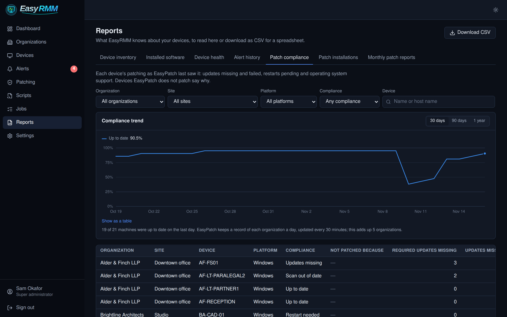

# Reports

**Reports** in the main menu answers fleet-wide questions from what EasyRMM
already knows: inventory, installed software, health measurements, alerts
and patching. Each report is a table to read in the console or download as
CSV for a spreadsheet. The design is in
[ADR-0029](../architecture/adr/0029-reports.md).

| Report | One row per | Answers |
|---|---|---|
| Device inventory | Device | What hardware and operating systems a client has; serial numbers for warranty checks; which agents are old |
| Installed software | Package or program on a device | Which devices have a program, and which version (search for its name) |
| Device health | Device | Which devices have not checked in for a while, or are running out of disk space |
| Alert history | Alert | What went wrong over a period, how long it lasted, and how it ended |
| Patch compliance | Device | Which devices are up to date, and which miss required, exploited or failed updates, wait for a restart or run an unsupported operating system; why a device is not patched |
| Patch installations | Update a job finished with on a device | What was installed over a period, what failed and why, and who asked for it |
| Monthly patch reports | PDF, per organization and month | A report to keep or send to a client (see [Patch reports](#patch-reports)) |

## Filters

Every report narrows to an **organization** and a **site**. Device
inventory, installed software and device health narrow to a **platform**
(Windows or Linux).

* **Device inventory**: a device's name or host name contains the search.
* **Installed software**: the package or program name contains the search
  (`openssl`, `chrome`).
* **Device health**: **Not seen for** (a day, a week, 30 or 90 days or
  more; devices never seen count) and **Fullest disk** (80%, 90% or 95%
  full or more).
* **Alert history**: **Opened in** (the last 7, 30 or 90 days, or the last
  year) and **Severity**.
* **Patch compliance**: **Platform**, **Compliance** (up to date, updates
  missing or failed, restart needed, scan out of date, never scanned) and a
  device's name or host name.
* **Patch installations**: **Finished in** (the last 7, 30 or 90 days, or
  the last year), **Category** and **Result** (installed, failed, skipped,
  cancelled); the search matches the device, the update's title or its KB.

The filters are part of the page's address, so a report can be bookmarked
or shared with someone who can see the same devices.

## Who can see what

Every built-in role holds `report.view`. A report lists only devices in
organizations and sites you can see, and needs the permission for what it
lists there: `device.view` for inventory and health, `software.view` for
software, `alert.view` for alerts, `patch.view` for the patch reports. The
compliance trend and monthly reports describe whole organizations, so they
need `report.view` and `patch.view` over the organization: a role over one
site sees its devices in the compliance and installations reports only.

## Downloading

**Download CSV** downloads the report as filtered, with every row (the
console shows the first 1,000). A report stops at 100,000 rows and says
so; narrow it with the filters.

* UTF-8 with a byte order mark, so Excel reads accented names correctly.
* Times are in UTC, as `2026-11-16 13:53:07`; the header says *(UTC)*.
* Numbers are in the unit the header names: GiB, %, days, hours.
* A cell that would start with `=`, `+`, `-` or `@` begins with an
  apostrophe, so that a name chosen on a managed computer cannot run as a
  formula when the file is opened.

Each download is recorded in the audit log as *Downloaded report*, with the
report, its filters and the number of rows.

The console reads them from
`GET /api/v1/reports/{devices|software|health|alerts|patch-compliance|patch-installations}`
(JSON) and `…/csv`, with `organizationId`, `siteId`, `platform`, `q`,
`offlineDays`, `diskPercent`, `days`, `severity`, `compliance`, `category`
and `result` as query parameters.
Like the rest of the API they need a signed-in session; EasyRMM has no API
keys yet.

## Patch reports

<picture><source media="(prefers-color-scheme: light)" srcset="../images/patch-reports-light.png"></picture>

The patch reports read the patching engine when they are opened
([Patching](patching.md)).

* **Patch compliance** is the device list on Patching as a report, with
  the operating system's build and support status from the engine's OS
  lifecycle data. A device the engine does not patch says why: its agent is
  not installed, failed to install or is being removed, or patching was
  stopped. Above the table, the **Compliance trend** adds up, day by day,
  the organizations in view you see whole; choosing a site does not narrow
  it.
* **Patch installations** lists each update the install jobs finished
  with, newest first: when, on which device, the update and its KB, its
  category, the result with the engine's reason for a failure or a skip,
  whether it needed a restart, and who asked for the job. It reads at most
  5,000 rows and says so.
* **Monthly patch reports** lists the PDFs the engine made of organizations'
  months, by hand or on a schedule, with whether each was emailed. Making,
  emailing and deleting one needs `patch.manage` over the organization;
  schedules, under Settings → Patching → Report schedules, need
  `patch.configure`. How email is sent, and what each action records in
  the audit log, is in [Patching](patching.md#reports).

The trend and the monthly reports come from
`GET /api/v1/patching/reports/trend` (`organizationId`, `days` from 7 to 365)
and `/api/v1/patching/reports/monthly` (`POST` with `organizationId`,
`year`, `month` and `includeEndpointList` to make one; `…/{id}/pdf`,
`POST …/{id}/send` with `recipients`, `DELETE …/{id}`); schedules from
`GET /api/v1/patching/report-schedules` and `PUT …/{organizationId}`.

