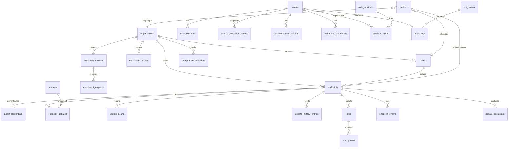

# EasyPatch Architecture

EasyPatch is a self-hosted Windows and Linux patch management platform for Managed Service
Providers. It has two parts:

1. **The server**: a Docker Compose stack in a DMZ, reachable on TCP 443.
2. **The agent**: a Windows service (`EasyPatchAgent`) or a Linux systemd service
   (`easypatch-agent`) on each managed endpoint. It only makes
   outbound HTTPS connections, so customer networks need no VPN, inbound rules or port
   forwarding. It works behind NAT and CGNAT.

The platform patches the Windows operating system, or the packages installed from a Linux
distribution's repositories, and does nothing else. The agent has no
remote shell and no arbitrary command execution. It restarts a computer only for an
administrator's restart job: a one-off restart, or one created by a restart schedule an
administrator configured in policy.

## 1. Component overview

```
                     Internet (TCP 443 only)
 ┌──────────────┐        │
 │ Windows agent├──HTTPS─┤      ┌───────────────────────── Docker host (DMZ) ─────────────────────────┐
 │ (LocalSystem)│        │      │  edge network                     data network (internal: no egress)│
 └──────────────┘        ├──────┼─► caddy ──/api,/downloads──► api ─────────────┐                      │
 ┌──────────────┐        │      │     │  (TLS, headers,              │  ▲         ▼                      │
 │ Admin browser├──HTTPS─┘      │     │   static SPA)                │  │     postgres (volume)          │
 └──────────────┘               │     └─ / (SPA files)               │  │         ▲                      │
                                │                          worker ───┘  └─migrate─┘                      │
                                └──────────────────────────────────────────────────────────────────────┘
```

| Container | Image | Purpose |
|---|---|---|
| `caddy` | `easypatch-proxy` (Caddy plus the built SPA) | Terminates TLS with automatic ACME certificates, enforces TLS 1.2+, adds security headers, serves the React SPA and reverse-proxies `/api/*` and `/downloads/*` to the API. |
| `api` | `easypatch-server` | ASP.NET Core 10 Web API. Handles admin auth, the admin REST API, the agent protocol and OpenAPI. |
| `worker` | `easypatch-server` (different entrypoint) | Background processing: job expiry and lease recovery, online/offline detection, scheduled installs, the end of rollout delays, scheduled restarts, compliance snapshots, alert evaluation and notification delivery (email, webhooks), retention. The only container with outbound access (`egress` network), used for SMTP and webhooks. |
| `postgres` | `postgres:18.6-alpine3.24` | System of record, including the durable job queue. Attached only to the internal `data` network. |
| `migrate` | `easypatch-server` | One-shot container that applies EF Core migrations before `api` and `worker` start. |

The SPA is served by Caddy, not by a separate frontend container. That was a deliberate
change from the original spec: a fifth container would have added nothing.

### Solution layout

```
shared/EasyPatch.Contracts      Wire DTOs, enums, request signing, update classifier (net10.0, no deps)
backend/Core                    Domain entities and pure domain logic (reconciliation, compliance, policy, lifecycle)
backend/Infrastructure          EF Core DbContext, migrations, application services
backend/API                     ASP.NET Core host: controllers, authentication, rate limiting, CLI commands
backend/Worker                  Background services host
backend/Tests                   Unit and integration tests (Testcontainers PostgreSQL)
agent/EasyPatch.Agent.Core      Platform-independent agent logic (scheduler, jobs, outbox, state)
agent/EasyPatch.Communication   Signed HTTPS client for the agent protocol
agent/EasyPatch.WindowsUpdate   Windows Update Agent (WUA) COM integration          [Windows]
agent/EasyPatch.Inventory       WMI and registry inventory, reboot and update-source detection [Windows]
agent/EasyPatch.Agent           Windows service host, tray app, DPAPI, CLI           [Windows]
agent/EasyPatch.Linux           apt/dnf backends, package ledger, inventory, reboot detection, systemd-creds [Linux]
agent/EasyPatch.Agent.Linux     systemd service host and CLI (easypatch-agent)       [Linux]
agent/EasyPatch.Agent.Tests     Agent logic tests (run on any OS using fakes)
agent/Installer                 WiX v5 MSI project; linux-packages: .deb/.rpm metadata, systemd unit
tools/EasyPatch.ReleaseSigner   easypatch-release: creates the release key, signs and verifies agent packages
frontend/                       React + TypeScript + Vite + Tailwind SPA
```

`EasyPatch.Contracts` is shared by the agent and the server. Both sides therefore serialize
identical DTOs, compute identical request signatures and classify updates the same way.

## 2. Domain model

Organizations contain sites, and sites contain endpoints. Every endpoint belongs to exactly
one organization and to at most one site. Each organization and site has a time zone, which
is used for maintenance windows.

### Entity relationship design



| Table | Key columns / notes |
|---|---|
| `users` | username (display name), email (the sign-in name; stored in lower case, unique on `lower(email)`), Argon2id `password_hash`, `role` (SuperAdmin, Admin, ReadOnly), MFA secret (protected with ASP.NET Data Protection), recovery code hashes, lockout counters, `security_stamp` |
| `user_sessions` | SHA-256 of the session token, MFA-completed flag, idle and absolute expiry, `revoked_at` |
| `webauthn_credentials` | Passkeys and security keys: credential ID (unique), public key, signature counter, AAGUID, transports, name, passkey and backup flags, created and last used |
| `webauthn_challenges` | Pending WebAuthn ceremonies: the options with their challenge, bound to a session or to the hash of a browser cookie; single use, 5-minute expiry |
| `oidc_providers` | Single sign-on providers: name, issuer, client ID, client secret (Data Protection), scopes, enabled, email trust, provider MFA, account creation (role, allowed domains) |
| `external_logins` | Links from users to provider accounts: issuer and subject (unique), provider, email at linking, created and last used |
| `oidc_login_states` | Pending single sign-on attempts: hash of `state`, nonce, PKCE verifier, browser-binding hash, return path; single use, 10-minute expiry |
| `user_organization_access` | When a non-SuperAdmin user has rows here, they can only see those organizations. No rows means all organizations. Managed under Settings → Users. |
| `password_reset_tokens` | Hashed, single-use, expiring tokens issued by an administrator |
| `api_tokens` | API tokens for scripts and integrations: SHA-256 of the secret, display prefix, `role` (ReadOnly or Admin), `all_organizations` or `organization_ids`, expiry, last use time and address, `revoked_at`. Managed under Settings → API tokens. |
| `organizations`, `sites` | `is_active` and `archived_at`. Archiving is preferred to deleting; hard delete is only allowed when no endpoints exist. |
| `endpoints` | Identity, OS and hardware inventory, agent version and capabilities, check-in, scan and inventory timestamps, reboot state and reasons, signed-in user and tray counts, update source, Windows Update policy status reported by the agent, OS support status, and denormalized compliance counters |
| `agent_credentials` | Public ID `c_…`, ECDSA P-256 **public key only**, expiry, revocation, `replaced_by` |
| `enrollment_tokens` | SHA-256 hash, display prefix, org (and optional site) scope, `max_uses` (default 1), `use_count`, expiry, revocation |
| `deployment_codes` | Non-secret code for tokenless (RMM) installs. Org and optional site scope, cap on pending requests, optional source CIDR allow-list, revocation |
| `enrollment_requests` | Pending tokenless enrollments: public key, fingerprint, reported device identity, source IP, status (Pending, Approved, Rejected, Expired) |
| `updates` | Update catalog keyed by (`update_guid`, `revision_number`). Holds KBs, title, description, MS classification, normalized category, products, severity, `last_deployment_change_time`, size, reboot behavior, superseded IDs; for Linux the package, version and source package; and a display summary of the CVEs and the known-exploited flag across endpoints |
| `endpoint_updates` | Per-endpoint state, unique by (`endpoint_id`, `update_guid`) so a revision bump never duplicates a row. Holds `state`, `is_required`, `is_excluded`, error code and message, timestamps, and the CVEs the update fixes on that endpoint with `known_exploited` and the KEV due date |
| `update_scans` | One row per scan report. `agent_scan_id` is unique per endpoint, which makes ingestion idempotent |
| `update_history_entries` | Windows Update history (installs and uninstalls with result and HRESULT), deduplicated by fingerprint |
| `update_exclusions` | Per-endpoint excluded updates (by GUID). Organization and site exclusions live in policy as KB lists. |
| `jobs` | Durable job queue. Holds lease and delivery tracking, payload and result (`jsonb`), progress, sequence number, dedupe key (partial unique index over active jobs), and an `xmin` concurrency token |
| `job_updates` | Per-update results inside an install job |
| `policies` | One global row plus optional organization, site and endpoint rows. Nullable fields override the level above. The restart schedule and Windows Update settings are `jsonb`. |
| `server_settings` | A single `jsonb` row for global limits, retention periods and credential lifetimes |
| `os_lifecycle_entries` | Editable lifecycle table (product, edition class, build, end of servicing) used for support status |
| `endpoint_events` | Per-endpoint activity (scans, jobs, enrollment, reboot changes, online and offline transitions) |
| `audit_logs` | Every administrative action, with user (or `token:<name>` for an API token), IP and correlation ID |
| `compliance_snapshots` | Daily per-organization counters for trend reporting |
| `vulnerabilities`, `msrc_kb_cves`, `msrc_build_fixes`, `debian_fixes`, `vulnerability_feeds` | Downloaded vulnerability data (see [section 8](#8-vulnerability-data)) and the state of each download |

### Update state model (two layers)

The **endpoint layer** (`endpoint_updates.state`) records what is true on the machine. It is
only changed by scans and final install results:

| State | Meaning |
|---|---|
| `Missing` | Applicable and not installed, according to the latest scan |
| `Failed` | Missing, and the last install attempt failed. The error is kept. |
| `PendingVerification` | The agent reported a successful install and the next scan has not confirmed it yet |
| `PendingReboot` | Installed, but Windows needs a restart to finish (WUA reports `RebootRequired`) |
| `Installed` | A scan reported it as installed. This is the only path to `Installed`. |
| `Superseded` | Replaced by another applicable update, inferred from `SupersededUpdateIDs` |
| `NotApplicable` | Previously reported, now absent from both scan lists and not superseded |
| `Excluded` | Excluded by an administrator (per endpoint) or by a policy KB list |
| `Reoffered` | Windows reported a successful install (no restart needed), but the next scan still offers the same revision. Not counted for compliance; automatic install jobs list it in `excludedUpdateGuids`; a new revision makes it `Missing` again |

The **job layer** (`job_updates.status`) records operational progress: `Pending`,
`Downloading`, `Downloaded`, `Installing`, `Succeeded`, `Failed`, `Skipped` (with a reason)
and `Cancelled`, with the download and install percentages the agent reported
(`download_percent`, `install_percent`). The UI overlays live job progress onto the endpoint
inventory. A crashed job
therefore can never leave the inventory stuck in "Downloading".

`is_required` is true when policy says the update should be installed now: its category is
allowed, it is not optional (unless optional updates are enabled), it is not excluded and its
rollout delay has ended. While the delay runs, `deferred_until` holds its end. The delay counts
from `delay_basis_at`: when the update was first seen in the fleet, or the start of an older
outstanding update it replaces. `Core/Domain/UpdateRequirement.cs` makes this decision for scan
ingestion, recomputation, the install preview and the scheduler. Compliance only counts updates
where `is_required` is true.

### Update categories

The categories come from `EasyPatch.Contracts.Updates.UpdateClassifier`, in this priority
order:

1. **Driver**: WUA `Type == Driver`, or the Drivers classification
2. **Feature**: the Upgrades classification, or a title starting with "Feature update to"
3. **Definition**: the Definition Updates classification
4. **ServicingStack**: the title contains "Servicing Stack Update"
5. **DotNet**: the title or product contains ".NET Framework" or ".NET"
6. **Cumulative**: the title contains "Cumulative Update"
7. **Security**: the Security Updates classification
8. **Critical**: the Critical Updates classification
9. **Other**: everything else

**Application** is used only for winget application updates (an update reported with
application details). It is never one of a policy's allowed categories; application updates are
approved by package ID instead (see [application-updates.md](application-updates.md)). Each one
is a catalog entry for one version of one winget package: the update GUID is derived from the
lower-cased package ID and the version (SHA-256, formatted as a version 8 UUID), the package ID
and version are stored as the update's package name and version with `winget` as the
repository, and the installed version is stored on the endpoint's update row. Because the
installed version is reported with the same GUID, the next scan after an upgrade marks the
update installed.

The original Microsoft classification is stored as well. Cumulative, ServicingStack and
DotNet are derived categories, not Microsoft classifications.

Linux package upgrades are **Security** when the Linux agent found them in a security
repository (apt) or covered by a security advisory (dnf), and **Other** otherwise. Each one is
a catalog entry for one version of one package on one distribution release (the update GUID is
derived from the distribution, release, package name, architecture and version), with the
package name, version, architecture, repository and advisories stored on the update and the
installed version on the endpoint's update row.

## 3. Policy

The effective policy is resolved in the order **global → organization → site → tags →
endpoint**. Scalar fields take the most specific non-null value. Lists (excluded KBs) are merged.
An endpoint policy is optional and holds only the values that differ for that one computer (its
editor has no per-site install limit).

**Tags** are MSP-wide labels (for example update rings such as "Pilot" and "Broad"). Super
administrators create tags and tag policies. Administrators without organization restrictions
assign tags to endpoints, sites and organizations (`endpoint_tags`, `site_tags`,
`organization_tags`); restricted users only see the tags of their own endpoints, sites and
organizations. An endpoint has its own tags plus those of its site and organization, so tagging
a site or a customer puts all of its computers in a ring. A tag policy applies to every
endpoint with the tag, however it got it; the tag filter, alert rule scopes and counts use the
same set. When an endpoint has several tags with policies,
they are applied in ascending priority, so the highest priority wins; on equal priority the
alphabetically first name wins. A tag policy cannot set the per-site install limit.

| Field | Global default |
|---|---|
| Check-in interval | 60 s (15 s while a job is active) |
| Scan interval | 360 min |
| Inventory interval | 1440 min |
| Jitter | ±10 % |
| Allowed categories | All except Driver and Feature |
| Include optional (BrowseOnly) updates | false |
| Excluded KBs | none |
| Accept EULAs | true |
| Auto-install | **false** |
| Maintenance window | none (days of week, start time, duration, in the site's or organization's time zone) |
| Download before the window | 0 hours (off; 0-24, Windows agents 1.8.0 and later) |
| Scan considered stale after | 48 h |
| Max concurrent installs per site | 10 |
| Rollout delay: security updates | 0 days |
| Rollout delay: other updates | 0 days |
| Tray icon | shown |
| Install notifications ("Updates are installing") | on |
| Restart schedule | none |
| Windows Update settings | each group *Not configured* |
| Agent updates | Automatic |

Global limits are stored in `server_settings`. The global max concurrent installs defaults
to 50.

### Restart schedules

A restart schedule has days of the week, a start time (in the site's or organization's time
zone), a condition (*always*, or *only if Windows reports a pending restart*), a restart mode
(see [Restart jobs](#restart-jobs)) and an expiry of 15 minutes to 24 hours. Every 2 minutes
the worker creates one `Restart` job (trigger `Scheduled`, requested by "Restart schedule")
for each endpoint whose schedule is due, unless the endpoint already has an active restart
job. A job is created at most once per occurrence, and it expires when the occurrence's
expiry period ends, so a computer that is off at the scheduled time is not restarted later.
With the *only if pending* condition, endpoints that did not report a pending restart are
skipped, and the agent checks again when the job starts. A lower level can switch an inherited
schedule off.

### Windows Update settings

Windows Update settings are grouped. Each group is resolved separately: the most specific
level that sets the group wins. A level can *inherit*, set the group to *Not configured*
(EasyPatch manages nothing in that group), or configure it. Managing a group means EasyPatch
decides every registry value of that group: values the configuration does not need are
deleted. All values are under `HKLM\SOFTWARE\Policies\Microsoft\Windows\WindowsUpdate`
(and its `AU` subkey):

| Group | Settings | Registry values |
|---|---|---|
| Automatic Updates | Disabled, notify before download, download and notify, or download and install on a schedule (day, hour) | `AU\NoAutoUpdate`, `AU\AUOptions`, `AU\ScheduledInstallDay`, `AU\ScheduledInstallTime` |
| Feature updates | Deferral (days); target product and release version (for example Windows 11, 24H2) | `DeferFeatureUpdates`, `DeferFeatureUpdatesPeriodInDays`, `TargetReleaseVersion`, `ProductVersion`, `TargetReleaseVersionInfo` |
| Quality updates | Deferral (days); prevent users from pausing updates | `DeferQualityUpdates`, `DeferQualityUpdatesPeriodInDays`, `SetDisablePauseUXAccess` |
| Restart behaviour | No automatic restart while users are signed in; active hours | `AU\NoAutoRebootWithLoggedOnUsers`, `SetActiveHours`, `ActiveHoursStart`, `ActiveHoursEnd` |

`WUServer`, `WUStatusServer`, `UseWUServer` and every other value are never written, so a
WSUS configuration stays in place. The effective policy view lists the exact registry values
an endpoint will receive. How the agent applies and restores them is described in
[Windows Update policy enforcement](#windows-update-policy-enforcement).

## 4. Job system

Job types are `UpdateScan`, `InstallUpdates`, `InventoryRefresh`, `Restart`,
`NotifyUser` (a preset message to signed-in users), `AgentUpdate`, `UninstallAgent`,
`UninstallUpdate` (removes one installed Windows update) and `DownloadUpdates` (downloads updates
ahead of a maintenance window without installing them).

```
Queued ──lease──► Delivered ──ack──► Acknowledged ──► Running ──► Completed
   │                 │ lease expiry                       ├─────► Failed
   │                 └──► Queued (redelivery, max 5)      ├─────► Cancelled
   ├──► Cancelled (admin)                                 └─────► WaitingForReboot ──(after reboot)──► Running
   └──► Expired (not delivered before expires_at)

Delivered / Acknowledged ──► Expired (the agent received it after its deadline)
Delivered / Acknowledged / Running / WaitingForReboot ──► Cancelled (admin)
Failed (timed out) ──► any final status (a late genuine report from the agent)
```

* **Persistence.** All job state lives in PostgreSQL, and nothing is held only in memory.
  The agent also stores the job it is working on in `C:\ProgramData\EasyPatch\state`.
* **Leasing.** A check-in leases the next job with `SELECT … FOR UPDATE SKIP LOCKED` inside a
  transaction. Two API instances can never deliver the same job. A delivered job that is not
  acknowledged within 10 minutes goes back to `Queued`.
* **One job at a time per endpoint.** A new job is only delivered when the endpoint has no
  job that is delivered, acknowledged or running. `NotifyUser` jobs are the exception: up to
  five are delivered with every check-in, even while another job runs, and they do not make
  the endpoint busy. A `Restart` job is delivered after the running job finishes, and while it
  waits for users no other job is delivered. While an install job is parked in
  `WaitingForReboot`, scans and inventory jobs are still delivered (the agent runs them while
  it waits), but further install jobs stay queued until the restart has been handled.
* **Agent capabilities.** Agents report what they support in every check-in (`restart`,
  `notify-user`, `tray`, `windows-update-policy`, `self-update`, `app-updates`, `uninstall`,
  `uninstall-updates`, `download-updates`). Restart, message, agent update, agent uninstall,
  update removal and download jobs can only be created for, and are only delivered to, agents
  that report the matching capability. For older agents the API answers
  `409 agent_upgrade_required`.
* **Priority.** When several jobs are queued for an endpoint, scans go first, then update
  removals, installs, downloads ahead of a window, restarts and agent updates.
* **Concurrency limits.** Install jobs are only delivered while the global limit and the
  per-site limit allow it. This check runs under a transaction-scoped advisory lock.
* **Deduplication.** A partial unique index on (`endpoint_id`, `dedupe_key`) covering active
  statuses blocks duplicate jobs. An administrator can override it explicitly with `force`.
* **Idempotency.** An install job always starts with a fresh scan, skips anything already
  installed and installs one update at a time. Re-running a job after a crash or reboot is
  therefore safe. Status reports carry a monotonically increasing per-job `sequence`, so
  stale or replayed reports are ignored.
* **Recovery.**
  * If the agent reconnects without a job the server considers active (for example after a
    reinstall), the job is delivered again.
  * A running job with no progress for 12 hours is marked `Failed` with `timed_out = true`.
    A later genuine report from the agent still updates it, so the record never shows a
    false outcome.
* **WaitingForReboot.** Used only when Windows reports `RebootRequiredBeforeInstallation`.
  The job continues automatically after the endpoint restarts. When installs succeed but a
  reboot is needed to finish them, the job **completes** with `reboot_required = true`, and
  the endpoint shows the pending reboot and which updates caused it.
* **Expiry.** Queued jobs expire after 7 days by default. Scheduled jobs expire when their
  maintenance window closes. A restart expires if the computer has not picked it up within its
  expiry period (default 2 hours, 15 minutes to 24 hours), so an offline computer is not
  restarted at a surprising time. A restart can be scheduled up to 31 days ahead; it is not
  delivered before that time.

### Restart jobs

| Mode | What signed-in users see |
|---|---|
| `Immediate` | Nothing; the computer restarts at once |
| `Countdown` | A countdown of 1 to 60 minutes (default 5). They can restart sooner but cannot postpone |
| `PromptWithDeadline` | A request to restart, with *Restart now* and *Postpone* (1 hour, 4 hours or 1 day, never past the deadline). The deadline is 15 minutes to 7 days (default 4 hours). At the deadline a 5-minute final countdown starts |
| `PromptNoDeadline` | The same request without a deadline. While someone is signed in, the computer is not restarted until a user accepts; the job fails with `restart_not_performed` after 7 days |

* **Only if pending.** With this condition the agent checks Windows' pending-restart state
  when the job starts. If no restart is pending, the job completes without restarting.
* **Restart all that need it.** The organization page (and each row of its *Sites* tab) lists
  the active endpoints whose last check-in reported a pending restart
  (`GET /organizations/{id}/restart-pending`). Confirming creates one restart job per listed
  endpoint that can restart, with the *only if pending* condition. Endpoints that left the
  scope or stopped reporting a pending restart since the list was shown are skipped.
* **Nobody signed in.** The computer restarts at once, whatever the mode.
* **Signed-in users but no tray.** For a countdown or the final countdown, Windows' own
  shutdown warning is shown for the remaining time instead. A prompt without a deadline keeps
  waiting for a tray.
* **Verification.** The agent asks Windows to restart (`InitiateShutdown`, with the planned
  "Operating System: Hot fix" shutdown reason) and records the boot time. The job completes only when the
  agent sees a new boot time after the restart. If Windows has not restarted 30 minutes after
  the request (plus any warning period), the job fails with `restart_not_performed`. If the
  computer was restarted by someone else while the job waited, it completes without another
  restart.
* **Progress.** While waiting, the agent reports progress every 30 minutes, so the server's
  running-job timeout does not end the job.
* **Cancellation.** Cancelling a waiting restart removes the prompt. If Windows is already
  showing its warning, the restart is aborted (`AbortSystemShutdown`); once Windows has
  started shutting down it can no longer be cancelled.

### Agent update jobs

An `AgentUpdate` job carries the package description (file name, version, architecture, size,
SHA-256), the release key ID and the release signature from the package's `.sig` file. The
server never signs anything; see [security.md](security.md#agent-release-signing).

* **Who creates them.** An Operator (*Update agent…*, one endpoint or bulk), or the worker's
  `agent-updates` task every 2 minutes for online endpoints whose effective *Agent updates*
  policy is Automatic. The task picks the newest package for the agent's architecture and
  package format (MSI, `.deb` or `.rpm`) that is newer than the installed agent and signed with
  a key the agent reported. It starts at most
  `EasyPatch:AutomaticAgentUpdateConcurrency` (default 25) agent update jobs at a time across
  the installation. After a failed or cancelled update of a version it waits 6 hours, and stops
  after 3 failures of that version (an Operator can still start it). Automatic jobs expire after
  24 hours.
* **Only one at a time.** An endpoint has at most one active agent update job.
* **On the agent.** The job runs like any other job (it waits for a running install). The agent
  verifies the signature, version and architecture, downloads the package to
  `C:\ProgramData\EasyPatch\updates`, verifies size and SHA-256, records in its state that it
  is installing, closes the trays and starts `msiexec /i <package> /qn /norestart`. Windows
  Installer stops the service, replaces the files and starts the new version.
* **Completion.** The new version finds the job in its state and completes it once its own
  version is at least the target. If the previous version comes back instead (Windows Installer
  failed and rolled back), it waits while Windows Installer is still busy (at most 30 minutes
  after the start) and then fails the job with the error from the installer log. If `msiexec`
  exits while the old agent is still running, the job fails with its exit code.

### Update removal jobs

An `UninstallUpdate` job rolls back one installed Windows update on one endpoint. Windows agents
1.8.0 and later report the `uninstall-updates` capability; Linux agents do not.

* **Who creates them.** An Operator, from an endpoint (*Installed* tab, or an update waiting for a
  restart on the *Updates* tab) or for every endpoint in an organization or site from the update's
  page. The server accepts only updates the endpoint reports as `Installed` or `PendingReboot`,
  and not application updates. By default it also adds an exclusion for the update on each
  endpoint, so EasyPatch does not install it again.
* **Payload.** The update ID, title, KB number (digits only) and category. Nothing else: there is
  no command, path or package name in the job.
* **On the agent.**
  1. Windows Update looks the update up among installed updates (`IsInstalled=1 and UpdateID='…'`,
     local records only). If Windows Update can uninstall it (`IsUninstallable`), the agent uses
     Windows Update's own uninstall. If the lookup fails, the agent goes on with DISM.
  2. Otherwise the agent lists the servicing packages with `dism /Online /Get-Packages` and picks
     the package named for the KB (`Package_for_KB…`). For a cumulative update it picks the
     installed `Package_for_RollupFix` package whose version matches the build in the update's
     title (for example `26100.2314`); when the title has no build, it uses the cumulative update
     package whose `/Get-PackageInfo` output names the KB. It removes it with
     `dism /Online /Remove-Package /PackageName:<package> /Quiet /NoRestart`. This is how Microsoft
     says to remove a cumulative update installed together with a servicing stack update.
  3. The removal counts only when DISM no longer lists the package as installed afterwards (it
     may be `Uninstall Pending` until the restart). DISM exit code `0x800F0825` (a permanent
     package, such as a servicing stack update) is reported as not removable.
  4. A scan follows, so the server sees what Windows now reports.
* **Never restarts.** All DISM runs pass `/NoRestart` and close DISM's input. When Windows needs a
  restart to finish, the job completes with `reboot_required = true` and the endpoint shows *An
  update removed by EasyPatch requires a restart*. Restarting stays an administrator's decision.
* **Outcomes.** `Completed` when the update was removed (or Windows had already queued its
  removal), or when it turned out not to be installed (the item is skipped with `NotInstalled`).
  `Failed` with `update_not_removable` when Windows does not allow the removal (for example most
  definition updates, or updates without a KB number that Windows Update cannot uninstall), with
  `update_still_installed` when DISM finished but the package is still installed, with the DISM
  exit code when DISM refused, or with `dism_failed` when DISM could not be started, could not list
  the packages, or did not finish in time (10 minutes to list, 2 hours to remove; DISM is then
  left to finish on its own, never killed part-way).
* **State on the server.** A removal does not change the update's state in EasyPatch. The scans
  that follow do: until the endpoint restarts, Windows usually still lists the update as
  installed. DISM writes its log to `C:\ProgramData\EasyPatch\logs\update-removal.log`.

### Downloading before the maintenance window

With automatic installation, a policy can download the updates before the maintenance window
opens (**Download before the window**, 1-24 hours; off by default), so the installation inside the
window does not spend its time downloading.

* **When.** The worker task `pre-downloads` (every 10 minutes) looks at Windows endpoints whose
  agent reports `download-updates` (1.8.0 and later) and that miss required updates. When the next
  window opens within the configured hours (and at least 15 minutes from now), it queues one
  `DownloadUpdates` job per endpoint and window. The job lists the same updates the window's
  installation would install: all eligible updates, or the due updates when a rollout delay is
  set. Updates on hold are left out. Nothing is queued while a window is open.
* **Deadline.** The job expires when the window opens, and its `notAfter` is the window's start:
  the agent does not start another download after that. Updates it did not get to are skipped with
  `WindowStarted`, and the installation downloads them.
* **On the agent.** A fresh scan and the same filter as the installation, then Windows Update's
  download for each update that is not downloaded yet. Nothing is installed, users get no
  notification, Windows' restart state is not checked and no scan follows. Windows Update keeps
  the downloads, and the installation skips downloading them again.
* **On the server.** Items end as `Downloaded` (or `Failed` when a download failed). A download
  never changes an update's state, compliance or the rollout guard's counts. Download jobs do not
  take install slots, but a site runs no more downloads at once than its per-site install limit.
  They are not retried (`409 not_retryable`): the next window gets a new one.

### Update holds and the rollout guard

An update on hold is not installed automatically. A hold applies to one organization or to every
organization (`update_holds`, at most one active hold per update and scope).

* **What a hold does.**
  * The install preview leaves held updates out of "install all" jobs (skip reason `Held`) by
    adding them to the job's excluded updates, and maintenance-window jobs do not list them. An
    endpoint that only misses held updates gets no scheduled job.
  * When an endpoint picks up a queued job, held updates are left out of it if the job is
    scheduled or an "install all" job, even when the hold was created after the job was queued.
    Their planned items are skipped with `Held`, and a scheduled job with nothing else left is
    cancelled.
  * An update an administrator selected by hand is still installed. The install preview warns
    that it is on hold.
  * The endpoint's *Updates* tab, the update list and the update's page show *On hold*. The
    *Update on hold* alert (one per organization) opens while endpoints of the organization still
    miss a held update.
* **The rollout guard** (worker task `rollout-guard`, every 5 minutes; **Settings → Server
  settings → Rollout guard**, on by default). It looks at install jobs on Windows endpoints in the
  last 7 days (application updates are not counted). For each update it takes every endpoint's
  latest result. When the update failed on at least 3 endpoints and at least 20% of the endpoints
  that tried to install it, the guard holds it for every organization. The reason states the counts.
  The three numbers are server settings. Results from before an administrator released a hold
  for every organization are not counted again.
* **Pilot groups.** The guard works best with a rollout delay: give a pilot site or tag a shorter
  delay than the others. The pilot endpoints install an update first, and if it fails there, it
  is held before the other endpoints are due.
* **Who holds and releases.** Operators hold and release updates for organizations they can
  access, on the update's page, or when they remove an update from endpoints (*Also put it on
  hold*). Only super administrators hold an update for every organization or release such a hold,
  including the guard's. Holding and releasing are audited (`update.hold`,
  `update.hold_released`).

## 5. Agent lifecycle

```
 install MSI ─► service start ─► bootstrap config (registry, ACL: SYSTEM + Administrators)
                                   │
       ┌──────── token ────────────┴──────────── deployment code ─────────────┐
       ▼                                                                       ▼
 POST /agents/enroll ─► Active                       POST /agents/enroll ─► PendingApproval
 (endpoint + credential created)                     POST /agents/enrollment/status (signed, poll)
       │                                              ◄── admin approves in GUI ──┘
       ▼
 Steady state loop (single process, background tasks):
   check-in every 60 s ±10 % ─► config, leased job, cancellations, rotate-credential flag
   scan every 6 h ±10 %      ─► WUA search ─► POST scan-results (+ history delta)
   inventory every 24 h      ─► WMI/registry ─► POST inventory
   job runner                ─► one job at a time, state persisted before each step
   restart handler, messages ─► every 5 s; prompts and notices go to the tray over a local pipe
   tray launcher             ─► starts the tray in each signed-in session (every 15 s)
   Windows Update policy     ─► applied after each check-in when configured
   outbox flusher            ─► reports persisted on disk, retried with exponential backoff
```

* **Identity.** At first start the agent generates an ECDSA P-256 key pair. The private key
  is stored as `C:\ProgramData\EasyPatch\agent.key`, protected with DPAPI (LocalMachine scope),
  in a directory whose ACL allows only SYSTEM and Administrators. Only the public key is sent
  to the server.
* **Every request is signed.** See [security.md](security.md#agent-request-signing).
* **Install job.** The steps are:
  1. Fresh WUA search.
  2. Filter by the job payload (mode, categories, optional updates, exclusions). Skip updates
     that need user input or have unaccepted EULAs (when EULA acceptance is disabled).
  3. Report the planned items.
  4. For each update: download, report, install, report. From 1.7.0 the Windows agent runs
     each download and installation as an asynchronous WUA job (`BeginDownload` /
     `BeginInstall`), reads its percentage every second, and reports it as the item's
     `downloadPercent` / `installPercent` at most every 10 seconds (and in the tray's current
     activity). The job percentage moves through each update's share of 5-95 %: the first
     half while it downloads, the second while it installs. Windows Update reports 0 % until it
     knows more, so 0 is not shown. The result is read with `EndDownload` / `EndInstall`,
     exactly as from the synchronous calls. If WUA does not accept the asynchronous job, the
     agent uses the synchronous `Download` / `Install` and reports no percentages. On service
     stop, a running download is aborted; an installation is never interrupted. Linux agents
     report how many packages are done instead (apt and dnf install them in one transaction).
  5. Run a post-install scan and send the scan results.
  6. Finish as `Completed` or `Failed`, with `reboot_required` if needed.
* **Reboot.** The agent reports pending-reboot state from WUA `SystemInfo.RebootRequired`,
  the CBS `RebootPending` and `PackagesPending` keys, the WU `RebootRequired` key and
  `PendingFileRenameOperations`, and lists the reasons. From 1.8.0, `PendingFileRenameOperations`
  counts only when a file is waiting to be replaced: files queued only for deletion (for example
  temporary files left by installers) are cleanup at the next start and need no restart. From
  1.5.3 it also reports what is behind them while a restart is pending (`RebootDetails`): the update IDs under the WU key, the
  servicing package names under the CBS keys, and the files queued in
  `PendingFileRenameOperations` (deleted or replaced; at most 25 listed, user names in profile
  paths replaced by `*`). The server names the updates from its catalog and the endpoint's
  updates (CBS package names give KB numbers) and shows them on the endpoint page with the
  updates that are installed and waiting for the restart (`PendingReboot`). Install jobs never
  restart the computer. The agent restarts it only for a `Restart` job (see
  [Restart jobs](#restart-jobs)).
* **Self-update.** Agents 1.2.0 and newer report the package architecture and the IDs of the
  release keys built into them, and can run `AgentUpdate` jobs (above). Linux agents also
  report their package format and install the package with apt or dnf in a transient systemd
  unit that outlives the agent's own restart.
* **Resilience.** On a service restart or reboot, the agent reloads its saved state and
  resumes the active job, which is idempotent. Reports wait in the on-disk outbox until the
  server accepts them. Network failures use exponential backoff with full jitter, up to
  15 minutes. Only one WUA operation runs at a time.
* **Respecting customer configuration.** WUA searches use the default server selection, so
  WSUS and Group Policy configuration are honored. The agent reports the update source (WSUS
  server, Windows Update or Microsoft Update), Windows Update for Business deferral policies
  and Automatic Updates mode. It changes Windows Update policy values only for the groups an
  administrator configured (below), and never the WSUS settings.


### Uninstall jobs

An `UninstallAgent` job has no payload. Agents 1.6.0 and newer that were installed from their
package report the `uninstall` capability and are the only ones the server delivers it to. The
agent removes its own package and nothing else: on Windows `msiexec /x` with the product code
it looks up from the MSI's fixed upgrade code, on Linux `apt-get remove easypatch-agent` or
`rpm -e easypatch-agent` in the transient unit `easypatch-agent-uninstall`. The package's
uninstall step stops the service and runs `unenroll` (which restores the Windows Update values
EasyPatch changed and tells the server). The server marks the job `Completed` when that
unenrollment arrives, decommissions the endpoint and cancels its other open jobs. If the agent
is still running after the removal (it failed or was rolled back), it reports the job
`Failed` with the installer's exit code. If the unenrollment never reaches the server, the job
times out like any running job.
### Linux agent

The Linux agent runs the same `EasyPatch.Agent.Core` runtime (check-in, scan, inventory, jobs,
outbox, restarts, self-update) with Linux implementations of the platform services:

| Service | Implementation |
|---|---|
| Updates | `PackageUpdateService` over `AptBackend` or `DnfBackend`. Scans refresh the package lists and list upgradable installed packages; installs run one apt or dnf transaction for the approved packages at exact versions, in the transient unit `easypatch-packages`, and verify the installed versions afterwards |
| Installed updates | A ledger (`/var/lib/easypatch/package-ledger.json`) of reported upgrades, kept for 30 days, reports them as installed or superseded once the package database shows a version at least as new |
| Reboot detection | `/run/reboot-required(.pkgs)`, `dnf needs-restarting -r`, a newer installed kernel of the running flavour |
| Restart | `shutdown -r +N <message>` and `shutdown -c`; signed-in users from `who` |
| Inventory | `/etc/os-release`, `/proc`, DMI, `systemd-detect-virt`, Ubuntu Pro status, the automatic-update tool |
| Key protection | `systemd-creds` with the host key, or file permissions |
| Bootstrap | `/etc/easypatch/agent.conf` |
| Agent update | `apt-get install` or `dnf install` of the verified package in the transient unit `easypatch-agent-update` |
| Uninstall | `apt-get remove easypatch-agent` or `rpm -e easypatch-agent` in the transient unit `easypatch-agent-uninstall` |

There is no tray, no user messages and no Windows Update policy. See
[linux-agent.md](linux-agent.md).

### macOS agent (experimental)

The macOS agent (experimental: in development and not for production use) runs the same
runtime with these platform services:

| Service | Implementation |
|---|---|
| Updates | `SoftwareUpdateService`: `softwareupdate --list` for scans; `--download <label>`, `--install <label>` (never `--restart`), then a new listing to confirm. Updates are identified by product and version (a UUIDv8 of `easypatch-macos-update|product|version`). On Apple silicon, updates that need a restart fail with `macos_owner_required` without being attempted |
| Installed updates | A ledger (`/Library/EasyPatch/data/softwareupdate-ledger.json`) of listed updates, kept for 30 days: an update that disappears from the list is installed only when `softwareupdate --history` records its version; an older version of a product is superseded by a newer listed one |
| Reboot detection | Updates the agent installed that are completed by a restart, recorded with the boot time; cleared by the next boot |
| Restart | `shutdown -r now` or `shutdown -r +N <message>`; cancelled by stopping the waiting `shutdown`; signed-in users from `who` |
| Inventory | `sw_vers`, `sysctl`, `scutil`, `system_profiler SPHardwareDataType`, `profiles status -type enrollment` |
| Key protection | File permissions |
| Bootstrap | `/Library/EasyPatch/agent.conf` |
| Agent update | `installer -pkg <package> -target /` in the one-shot launchd job `com.dhitechnical.easypatch.agent-update` |
| Uninstall | `/Library/EasyPatch/uninstall.sh` in the one-shot launchd job `com.dhitechnical.easypatch.agent-uninstall` |

There is no menu bar icon, no user messages, no update removal and no downloads before the
maintenance window (the agent does not advertise the `download-updates` capability). See
[macos-agent.md](macos-agent.md).

### Tray

The tray is the same executable started as `EasyPatch.Agent.exe tray` in each signed-in
user's session. The service starts it (`WTSQueryUserToken` and `CreateProcessAsUser`, as the
signed-in user, not as SYSTEM) in every active session that has no tray, checking every 15
seconds and waiting at least 2 minutes before starting it again in the same session. The tray
exits when it cannot reach the service for a minute, or when the service stops.

* **What it shows.** An icon whose tooltip shows the agent version and a one-line status, with
  a menu: the agent's activity, the time of its last contact with the server, and whether a
  restart is pending. Clicking it opens the status window (agent 1.5.0 and later): a summary,
  connection and update details, *Check in now*, *Check for updates* and the recent agent
  log. Preset messages appear as notifications, and a pending restart opens a small window
  with *Restart now* and, when allowed, *Postpone*. When the policy setting *EasyPatch icon in
  the notification area* is *Hide*, the icon appears only while a message or restart request
  is shown.
* **Status window requests.** *Check in now* wakes the communication loop for an immediate
  check-in; *Check for updates* makes the work loop run a scan with trigger `User` instead of
  the next scheduled one. The runtime limits them for the whole computer (a check-in every 30
  seconds; an update check every 5 minutes, and not while the Windows Update lock is held),
  and the broker answers a tray that repeats a request within 2 seconds with "please wait".
  The log comes from the tail of `agent.log` (and `agent.1.log` after a rotation): the newest
  200 information, warning and error entries, first line only, redacted again.
* **Connection.** The service listens on the named pipe `\\.\pipe\EasyPatchAgent`. Frames
  are a 32-bit little-endian length and UTF-8 JSON. The service accepts frames of at most
  16 KB from a tray and sends at most 256 KB (the log); anything malformed closes the
  connection.

### Windows Update policy enforcement

After each check-in the agent applies the effective Windows Update settings, group by group:

1. **Before the first change** to a group, the agent saves the group's current values in its
   state file.
2. It writes the values that differ, and reports the group as `Applied`.
3. At later check-ins it compares the registry with what it wrote. If another policy source
   (such as domain Group Policy, Intune or a script) changed a value, the group is reported as
   `Conflict`, with the values involved, and the agent **stops** re-applying it, so the two
   sources never fight over the registry. Changing the EasyPatch settings for the group applies
   them again.
4. When a group is no longer managed (*Not configured*, or the override was removed), the agent
   restores the saved values. A value that another source changed since EasyPatch wrote it is
   left as it is. The same restore happens when the agent is uninstalled and when its
   credential is revoked.
5. A registry error is reported as `Error` and retried at the next check-in.

The report is sent when it changes and at least once a day, and includes whether MDM (Intune)
update policies are present, because those can take precedence over the registry values.

## 6. Docker deployment design

* **Networks.** `edge` connects Caddy and the API. `data` is internal (no egress) and connects
  the API, worker, migrate and PostgreSQL. PostgreSQL publishes no ports. `egress` gives the
  worker outbound connections for notifications (SMTP and webhooks), vulnerability data and
  the winget release; nothing is published on it. The API reaches single sign-on providers
  through `edge`.
  The diagram above omits it.
* **Volumes.**
  * `pgdata`: the database.
  * `caddy_data` and `caddy_config`: certificates.
  * `dpkeys`: ASP.NET Data Protection keys, which protect MFA secrets, notification secrets
    (SMTP password, webhook URLs, webhook signing keys) and single sign-on client secrets. The API creates and rotates the keys;
    the worker mounts the volume read-only to decrypt notification secrets.
  * `./data/agent-packages`, mounted read-only: agent MSIs offered for download.
  * `winget`: the server's copy of the pinned winget release (see
    [Installing winget](#installing-winget)). The worker writes it; the API mounts it read-only.
* **Secrets.** The database password is a Compose secret file (`secrets/db_password`, created
  by `scripts/init-secrets.sh`). No secrets live in images or in source control.
* **Hardening.**
  * Images are pinned by version.
  * .NET containers run as the non-root `app` user with a read-only root filesystem and
    `no-new-privileges`.
  * Caddy drops all capabilities except `NET_BIND_SERVICE`.
* **Health checks.**
  * API: `/health/ready` (database reachable) and `/health/live`.
  * Worker: an internal `/health` endpoint that reflects its last loop heartbeat.
  * Postgres: `pg_isready`.
* **Restart policy.** `unless-stopped` for everything except `migrate`.
* **Logs.** JSON to stdout, with a correlation ID on every request.
* **Development.** `docker-compose.dev.yml` switches Caddy to its internal CA
  (`local_certs`) and publishes HTTPS only on `127.0.0.1:8443`.

## 7. Alerts and notifications

The worker evaluates alert rules every two minutes (task `alerts`) and sends queued
notifications every 30 seconds (task `notifications`). Both run under PostgreSQL advisory locks
like the other worker tasks.

* **Tables.** `alert_rules` (seven default rules, seeded by the migration, with no channels);
  `alerts` (a partial unique index on `dedupe_key` for unresolved alerts: one open alert per rule
  and endpoint, or per rule and organization for enrollment requests); `notification_channels`;
  `notification_settings` (one row: SMTP); `notification_deliveries` (the outbox).
* **Lifecycle.** An alert opens when a subject matches an enabled rule and resolves after two
  consecutive evaluations without a match. A subject that matches again within an hour of
  resolving reopens the same alert without a new notification. Offline endpoints raise only the
  offline alert. Alerts of disabled or deleted rules, archived organizations and removed endpoints
  close without notifications.
* **Outbox.** Each evaluation writes at most one delivery per channel and kind (opened, resolved,
  reminder), listing up to 25 alerts. The dispatcher retries failures after 1, 2, 4… minutes (at
  most an hour apart) and gives up after 24 hours (tests: after 3 attempts).
* **Webhook egress guard.** Webhook requests go through a handler that resolves the host name,
  checks every address and connects only to allowed ones (see [security.md](security.md#notifications-and-webhooks)).

See [alerts.md](alerts.md) for the rules and the channel formats.

## 8. Vulnerability data

The worker task `vulnerability-feeds` runs hourly under an advisory lock and downloads what is
due (`VulnerabilityFeedService`):

| Feed | Interval | Stored as |
|---|---|---|
| CISA KEV catalog (`www.cisa.gov`, fallback `raw.githubusercontent.com/cisagov/kev-data`) | 6 hours | `vulnerabilities.kev`, dates, ransomware flag |
| MSRC CVRF documents of the last 12 months (`api.msrc.microsoft.com`) | daily; only documents whose `CurrentReleaseDate` changed are downloaded again | `vulnerabilities` (title, severity, CVSS, exploited), `msrc_kb_cves`, `msrc_build_fixes` (lowest fixed revision per build and CVE) |
| Debian Security Tracker (`security-tracker.debian.org`, about 90 MB, streamed) | daily while Debian 12/13 endpoints are managed; sooner (at most every 6 hours) when they report new source packages | `debian_fixes`, only for the releases and source packages in use |

A failure is stored in `vulnerability_feeds.last_error` (host and HTTP status only) and retried
after an hour; the previous data stays in use. When a feed brings new data, every active endpoint
is recomputed.

`VulnerabilityMatcher` sets `endpoint_updates.cve_ids`, `known_exploited` and `kev_due_date` for
open rows (missing, failed, pending verification, excluded). It runs in scan ingestion and in
`ComplianceService.RecomputeAsync`, before the requirement flags, because a known-exploited update
can skip the rollout delay (`UpdateRequirement`, policy `knownExploitedSkipsDelay`). Windows rows
get the CVEs of their KB numbers, and the security cumulative update also those fixed in a later
revision of the endpoint's build; Debian rows those fixed in their source package between the
installed and the offered version (`DebianVersion.Compare`); RHEL-family and Fedora rows keep the
CVEs the agent read from the dnf advisories. `endpoints.known_exploited_missing_count` and the
catalog summary on `updates` are then refreshed.

## 9. Monthly reports

`MonthlyReportDataBuilder` reads one organization's data for a `ReportPeriod` (a calendar month in
UTC dates; the current month ends today): endpoint rows, `endpoint_updates` installed in the month,
failed `job_updates` completed in the month, and the month's `compliance_snapshots`.
`ReportPdfRenderer` lays it out with MigraDoc (PDFsharp 6.2.4, MIT) on A4 with the embedded
Liberation Sans font (`ReportFontResolver`; the server needs no installed fonts).

| Table | Contents |
|---|---|
| `report_schedules` | One row per organization: `enabled`, `recipients`, `day_of_month` (1-28, organization time zone), `include_endpoint_list`, `enabled_at`, `last_scheduled_period` |
| `generated_reports` | The PDF (`content`, `sha256`, `file_name`), the period, `scheduled`, `generated_by`, and its email state (`delivery_status`, `recipients`, `attempts`, `next_attempt_at`, `queued_at`, `sent_at`, `last_error`). A unique index allows one scheduled report per organization and month |

The API generates on-demand reports synchronously (`POST /monthly-reports`). The worker task
`monthly-reports` (every minute, advisory lock) creates due scheduled reports
(`MonthlyReportService.NextScheduled`: the previous month, from the chosen day, skipping months
that ended before `enabled_at` or are already recorded in `last_scheduled_period`), then sends
pending emails through `INotificationTransport` with the PDF attached. Report emails use their own
outbox fields rather than `notification_deliveries`, which are bound to channels. The retention
task deletes reports older than `RetentionReportsMonths`.

## 10. Application updates (winget)

Policy: `policies.application_updates` (jsonb, `ApplicationUpdateSettings {enabled, approvedApps}`)
is resolved as a unit like the restart schedule. `EffectivePolicy.ToAgentConfig` sends
`AgentConfig.Applications` only while it is on with at least one approved ID, and `ToFilter` puts
the IDs in `InstallFilterOptions.ApprovedApplications`, which every install job carries.
`InstallFilter` decides Application updates by that list in every mode, independently of the
allowed categories.

Agent: `AgentRuntime` wraps the Windows Update service in a `CompositeUpdateService` when the
platform provides an `IApplicationUpdateService` (Windows only; the agent then reports the
`app-updates` capability). After a successful Windows Update scan, and only while the current
configuration enables it, the composite asks `WingetApplicationUpdateService` to check the
approved IDs and appends the results, with an `ApplicationScanReport` (succeeded, error, winget
version, number checked) on the scan report. Installs are routed by handle type; the download
step of an application update is a no-op because winget downloads during the upgrade.
`WingetProcessRunner` finds `winget.exe` in the newest `Microsoft.DesktopAppInstaller` package
under `%ProgramFiles%\WindowsApps`, runs it with an argument vector, caps the output at 4 MB and
kills the process tree on timeout. `WingetOutput` finds a package's row in `winget list` output by
its ID rather than by the (translated) column headers.

Server: `ScanIngestionService` drops malformed application updates, records `winget_version`,
`application_scan_at` and `application_scan_error` on the endpoint, and, when the application
check failed, keeps the existing Application rows instead of ageing them out
(`UpdateReconciler`'s `keepWhenUnreported`). When the report has no application section
(application updates off), unreported Application rows become NotApplicable like any other row.

### Installing winget

Agents 1.7.0 and later make sure a machine-wide winget exists (`WingetSetupService`, started with
the check-in session). The release is pinned in `EasyPatch.Contracts.Agent.WingetDistribution`:
version, file names, sizes and SHA-256 values of the App Installer bundle, the dependency
archive and the license file. The service:

1. runs 3 to 6 minutes after start, then every 24 hours, and after a failure after 30 minutes,
   2 hours, 6 hours, then daily (15 minutes when the server answered 503 because it is still
   fetching its copy). The state (`AgentState.Winget`) survives restarts;
2. does nothing more when `IWingetRunner` finds winget 1.6 or newer
   (`WingetApplicationUpdateService.MinimumVersion`), or when the platform reports that winget
   is unsupported (build below 17763, or not x64/ARM64);
3. checks for 1.5 GB of free space, then downloads each file to
   `C:\ProgramData\EasyPatch\winget`, trying `IWingetFileSource`s in order: GitHub
   (`HttpWingetFileSource`, HTTPS only, at most five redirects) and the EasyPatch server
   (`ServerWingetFileSource`, `GET /downloads/winget/{file}` through `AgentApiClient`). A file is
   accepted only with the pinned size and SHA-256;
4. extracts only `<arch>/<name>.appx|.msix` entries of the dependency archive;
5. waits while the agent has a job to run (at most 2 hours), then calls
   `IWingetProvisioner`. On Windows, `WindowsWingetProvisioner` runs
   `%SystemRoot%\System32\dism.exe /Online /Add-ProvisionedAppxPackage` with the bundle, each
   dependency and the license as an argument vector, with `/NoRestart` (exit codes 0 and 3010
   are success; 30-minute timeout);
6. checks the winget version again, deletes the work directory, logs event 1018 or 1019, and
   reports `WingetStatusReport` (version, whether the agent installed it, the error, when it
   checked) in every check-in.

Server: check-in stores the version in `endpoints.winget_version` and the error in
`winget_setup_error`; the endpoint DTO's `applications` section carries both, plus the
server's own download error while the agent reports one. `GET /downloads/winget/{file}` is
anonymous. It serves only the three pinned names, and only after `WingetMirrorService` has
verified the file's size and SHA-256 (cached by length and modification time). It looks first in
`data/agent-packages/winget/` (copies an administrator placed there), then in the `winget`
volume. When it has no verified copy, it records the request in `mirror_states` (at most every
10 minutes) and answers 503 with `Retry-After: 900`. The worker task `winget-mirror` (every
5 minutes, advisory lock) then downloads the missing files from GitHub to `.part` files,
verifies them and moves them into place. Failed downloads are retried after 15 minutes, 1 hour,
6 hours, then daily, with the error in `mirror_states.last_error`. The API has no egress, so only
the worker downloads.
